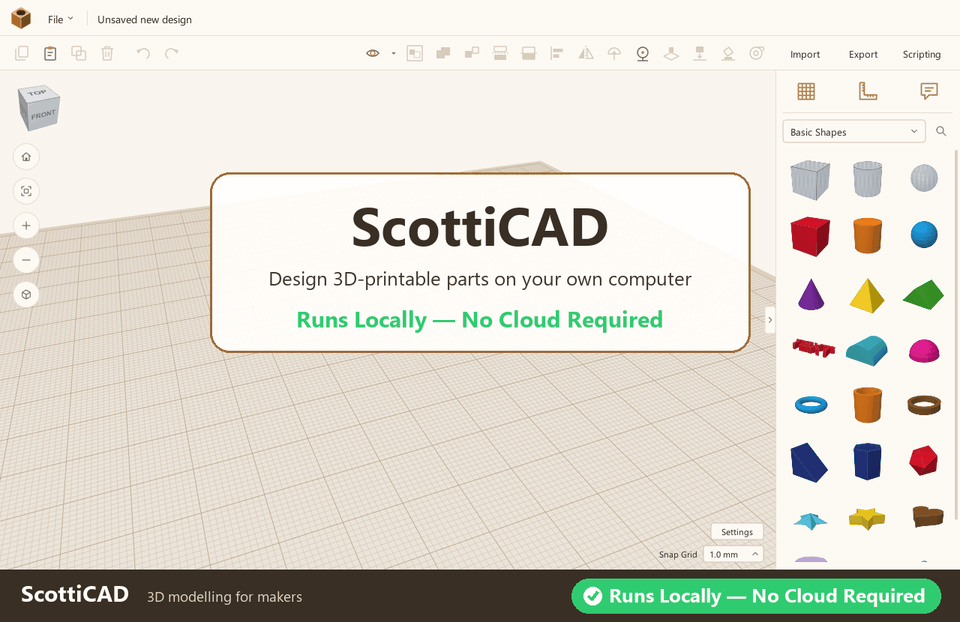

<h1 align="center">ScottiCAD</h1>

<p align="center">
  <b>Simple, fast 3D modelling for makers — on your own computer.</b><br>
  Drag shapes together, cut holes, group, measure, and export for 3D printing.
</p>

<p align="center">
  <b>✅ Runs locally — no cloud required.</b> No account, no sign-in, no upload, no internet connection needed.
</p>

<p align="center">
  <a href="https://github.com/scotticad/scotticad/releases/latest"><b>⬇ Download for Windows</b></a>
  &nbsp;·&nbsp;
  <a href="https://www.scotticad.com/"><b>🌐 www.scotticad.com</b></a>
</p>

<p align="center">
  
</p>

<p align="center">
  <!-- RELEASE: badges update themselves once the first release is published -->
  <a href="https://github.com/scotticad/scotticad/releases/latest"></a>
  <a href="https://www.scotticad.com/"></a>
  <a href="LICENSE"></a>
  
</p>

---

## Download

ScottiCAD is distributed as a ready-to-run program on GitHub Releases.

**[⬇ Download the latest release](https://github.com/scotticad/scotticad/releases/latest)**

<!-- RELEASE: name the release asset scotticad-vX.Y.Z-windows-amd64.zip
     (e.g. scotticad-v0.1.0-windows-amd64.zip) so these steps match -->
1. On the [latest release](https://github.com/scotticad/scotticad/releases/latest)
   page, under **Assets**, download the Windows zip file
   (`scotticad-vX.Y.Z-windows-amd64.zip`, where X.Y.Z is the version).
2. Unzip it anywhere — your Documents folder, a USB stick, wherever you like.
3. Run **`scotticad.exe`**. There is no installer and nothing else to set up.

To update, download the new release and replace the old folder; your
designs are separate files and are not affected. Older versions are on the
[Releases page](https://github.com/scotticad/scotticad/releases).

**Requirements:** Windows 10 or 11 (64-bit) and graphics that support
OpenGL 3.3 — practically any PC from the last ten years.

> **Windows SmartScreen:** because the program is new and not code-signed,
> Windows may say it "protected your PC" the first time you run it. Click
> **More info → Run anyway**. You can always [build it yourself](#building-from-source)
> from the source code instead.

<!-- RELEASE: optionally list checksums here, e.g.
     SHA-256 (scotticad-vX.Y.Z-windows-amd64.zip): <hash> -->

---

## Why ScottiCAD?

### 🔒 Your designs stay yours
Everything happens on your computer. Designs are ordinary files that you
save where you want, back up how you want, and open years from now — even
offline, even if this project disappears. Nothing is uploaded, tracked or
locked behind an account.

### ⚡ Fast and lightweight
A single small program with no installer, no browser and no background
services. It opens in a moment, works smoothly with big designs, and
combines shapes in the background so the window never freezes.

### 🧱 Easy to learn
Model the way you'd build with blocks: drag shapes onto the build plate,
turn some of them into **holes**, and **group** them to combine — the holes
are cut away. Resize with handles or type exact sizes, rotate with the
protractor, and line things up with the align tool. If you've used a
shape-based modeller before, you'll feel at home in minutes.

### 📐 Precise when you need it
- Exact sizes in **millimetres or inches**, typed straight into the
  on-screen dimensions
- A **ruler** you can drop anywhere, measuring to edges or midpoints
- **Align**, **mirror**, snap grid and arrow-key nudging
- A **construction plane** you can put on any shape, lined up with its own
  axes, so you can build on tilted surfaces
- **Notes** pinned to parts, for the details you'll forget

### 🛠️ Made for 3D printing
- **Export** to 3MF (with colours), STL, OBJ and GLB (glTF), or to SVG for
  laser cutting
- **Import** STL, OBJ and SVG files — just drag them onto the window
- Watertight exports, with holes and groups fully resolved
- **Split** parts with a plane, **lay** any face flat on the build plate,
  and look inside with **section view**
- A **filament estimate** in grams, metres and cost, from your slicer
  settings
- **Build plate presets** for popular printers

### 🧩 A useful shape library
Basic shapes, text in several fonts, and ready-made parametric parts:

| | |
|---|---|
| **Hardware & enclosures** | project box with lid, extruded box with end panels, PCB standoff, rounded plate, vent grille, hex nut and bolt, nut trap, countersunk and counterbored holes |
| **Mechanical** | involute spur gear and rack, spring, pipe elbow, knurled knob, print-in-place hinge |
| **Parametric** | ISO metric thread, round-tooth gear, hyperboloid, spherical shell, square grid, puffy box |
| **Computers & networking** | laptop, monitor, keyboard, server, equipment rack, router, switch, 3D printer and more |

Every part's controls (pitch, teeth, wall thickness…) stay editable after
you place it. Search finds shapes by everyday words like *screw*, *enclosure*
or *gear*.

### 🗂️ Nothing is ever flattened
Groups keep their parts, so you can always ungroup and change your mind.
Undo and redo reach back 500 steps.

### 🤖 Scriptable
Write scripts right inside ScottiCAD in a Python-style language
([Scripting](#scripting)), or drive it from your own Python programs
through the automation API ([Automation](#automation)). Both use the same
commands.

### 🆓 Free and open source
Apache-2.0 licensed. Use it for anything, including commercial work.

---

## Getting started

1. **Add shapes** — drag them from the panel on the right onto the build plate.
2. **Make a hole** — select a shape and press **H** (or click *Hole*).
3. **Combine** — select the shapes and press **Ctrl+G**. Holes are cut away.
4. **Size and place** — drag the handles, or click any dimension and type a number.
5. **Export** — *File → Export…* and choose STL for your slicer.

Press **?** in the program for the full list of keyboard shortcuts. A few
favourites:

| Action | Keys |
|---|---|
| Orbit / pan / zoom | Right-drag / Shift+right-drag or middle-drag / wheel |
| Group / ungroup | Ctrl+G / Ctrl+Shift+G |
| Hole / solid | H / S |
| Duplicate | Ctrl+D |
| Align / mirror | L / M |
| Split with a plane | K (then X / Y / Z, Enter) |
| Section view (see inside) | Shift+K |
| Lay a face flat | Shift+D, then click the face |
| Ruler / construction plane / notes | R / W / N |
| Drop down | D |
| Fit view | F |

---

## Scripting

Click **Scripting** (top right) to open the console under the 3D view.
Type at the `>>>` prompt, or use the **Editor** tab for longer scripts
(**F5** runs, **Ctrl+S** saves). *File → Run script…* opens a script and
runs it.

```python
# eight pegs in a ring
for i in range(8):
    a = 2 * math.pi * i / 8
    cad.add_shape("cylinder", x=40 * math.cos(a), y=40 * math.sin(a))
```

Scripts are written in [Starlark](https://github.com/google/starlark-go),
a dialect of Python: functions, loops, lists, dicts and comprehensions
work as in Python; there are no classes, `try`/`except` or `import`. The
`cad` object has the same methods as the [Python client](#automation), so
code moves easily between the two. Type `help()` for the list.

- `print` output, results and errors appear in the console; click an
  error to jump to its line in the script.
- A whole run undoes with one **Ctrl+Z**.
- **Stop** (or **Ctrl+C**) ends a script that runs too long.
- Scripts can't touch your files, the network or other programs, apart
  from the files they name in `cad` calls (`cad.open`, `cad.save`,
  `cad.export`, `cad.import_file`, `cad.screenshot`).

### Outlines and lofts

Two shapes are made from points rather than the library, so they come
from scripts (or the [Python client](#automation)). Points are millimetres
in the design's coordinates, and the shape lands exactly where they say; after that
it moves, resizes, groups and becomes a hole like any other shape.

```python
# an outline: closed outlines extruded straight up (ones inside others are holes)
plate = cad.add_outline([[(0, 0), (40, 0), (40, 25), (0, 25)],
                         [(15, 8), (25, 8), (25, 17), (15, 17)]], z0=0, z1=3)

# a loft: one outline per height, joined with straight walls
def ring(r, n):
    return [(r * math.cos(2 * math.pi * i / n), r * math.sin(2 * math.pi * i / n)) for i in range(n)]

vase = cad.add_loft([(0, ring(20, 6)), (40, ring(28, 48)), (80, ring(12, 48)), (95, ring(16, 48))])
```

- Outlines with the same number of points are joined point to point, so
  corners meet corners; otherwise each gets the other's points along its
  edges.
- Set the shape's **Smooth** parameter to make each outline a curve through
  its points; give a point twice in a row for a sharp corner.
- `cad.set_outline` and `cad.set_loft` replace the points later; the shape
  keeps any move, turn or resize it has had since.

Designs with outlines or lofts are saved in file format 2, which earlier
ScottiCAD versions won't open (rather than lose the shapes).

---

## Automation

Start ScottiCAD with the automation API and drive it from Python:

```python
from scotticad import launch   # the client is in python/scotticad

with launch(headless=True) as cad:
    box  = cad.add_shape("box", x=0, y=0)
    hole = cad.add_shape("cylinder", hole=True)
    cad.set_size(x=8, y=8, ids=[hole])
    cad.select([box, hole])
    cad.align("x", "center"); cad.align("y", "center")
    cad.group("union")
    cad.export("part.stl")
```

The client lives in [`python/scotticad`](python/scotticad) in this
repository. `launch()` starts the `scotticad.exe` at the top of the
repository; set the `SCOTTICAD_EXE` environment variable to use one from a
release instead.

The API speaks JSON-RPC 2.0 over a local socket
(`scotticad.exe --api 127.0.0.1:47800`), so any language can use it.
Everything the editor can do is available, including simulated mouse and
keyboard input.

---

## Building from source

You need [Go](https://go.dev/dl/) 1.25 or newer. No C compiler or other
libraries are required. The test suite also needs Python 3.

```powershell
git clone https://github.com/scotticad/scotticad.git
cd scotticad
.\build.ps1          # builds scotticad.exe
.\build.ps1 -Test    # also runs the Go and Python test suites
```

Or with Go directly:

```
go build -trimpath -ldflags "-H windowsgui -s -w" -o scotticad.exe ./cmd/scotticad
```

On Linux or macOS, Go can cross-compile the Windows program (no Windows
machine needed):

```sh
GOOS=windows GOARCH=amd64 go build -trimpath -ldflags "-H windowsgui -s -w" -o scotticad.exe ./cmd/scotticad
```

The version shown in *File → About ScottiCAD* comes from the [`VERSION`](VERSION) file.
`release.ps1` (Windows) and `release.sh` (Linux, macOS) build the release
zip for that version.

---

## Contributing

Bug reports and ideas are welcome — please open an
[issue](https://github.com/scotticad/scotticad/issues). Pull requests are
welcome too; run `.\build.ps1 -Test` before submitting.

## Links

- Website: **[www.scotticad.com](https://www.scotticad.com/)**
- Downloads: [GitHub Releases](https://github.com/scotticad/scotticad/releases)
- Bug reports and ideas: [Issues](https://github.com/scotticad/scotticad/issues)

## License

ScottiCAD is licensed under the [Apache License 2.0](LICENSE).
See [NOTICE](NOTICE) and [THIRD_PARTY_NOTICES.md](THIRD_PARTY_NOTICES.md)
for attributions.
