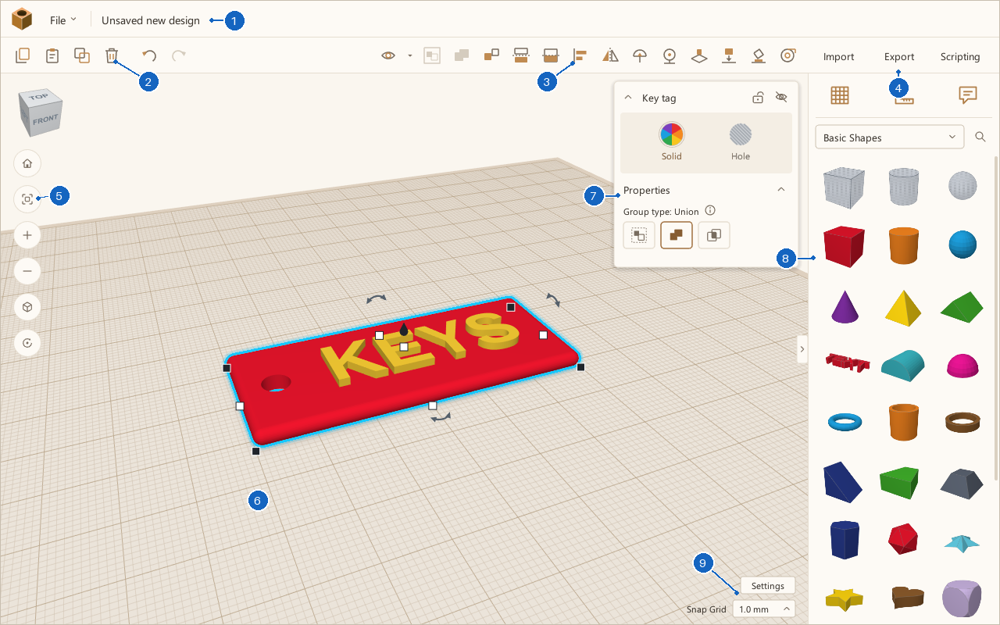
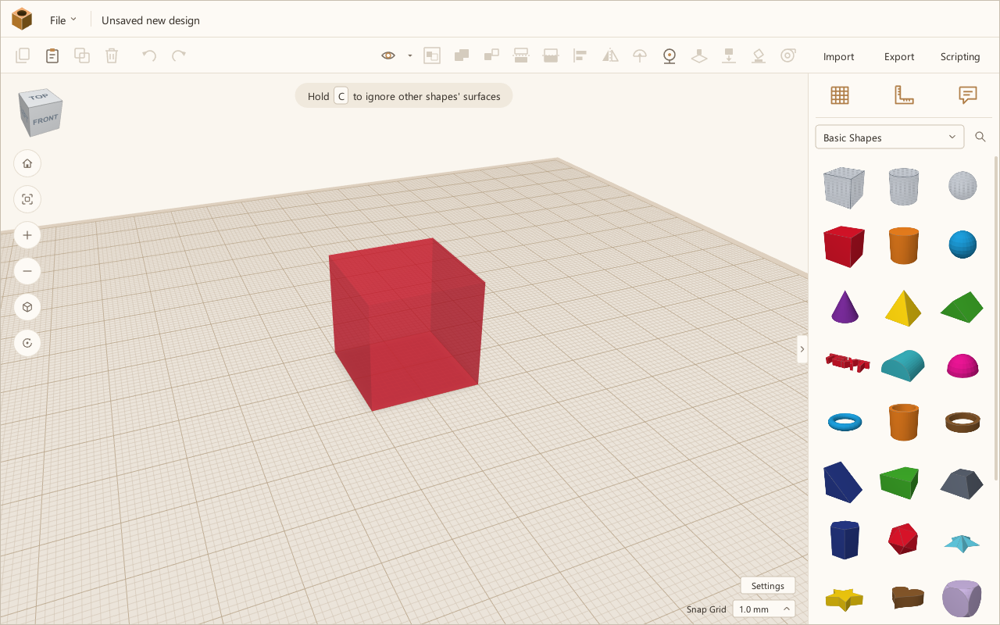
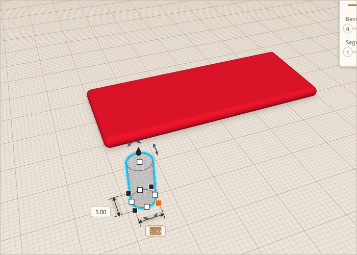
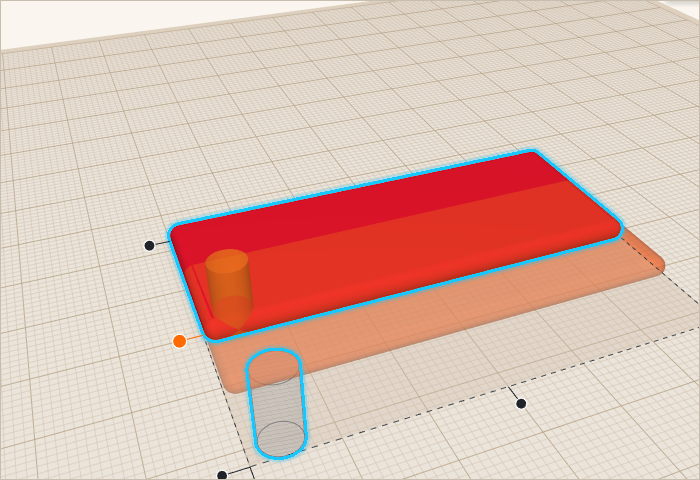
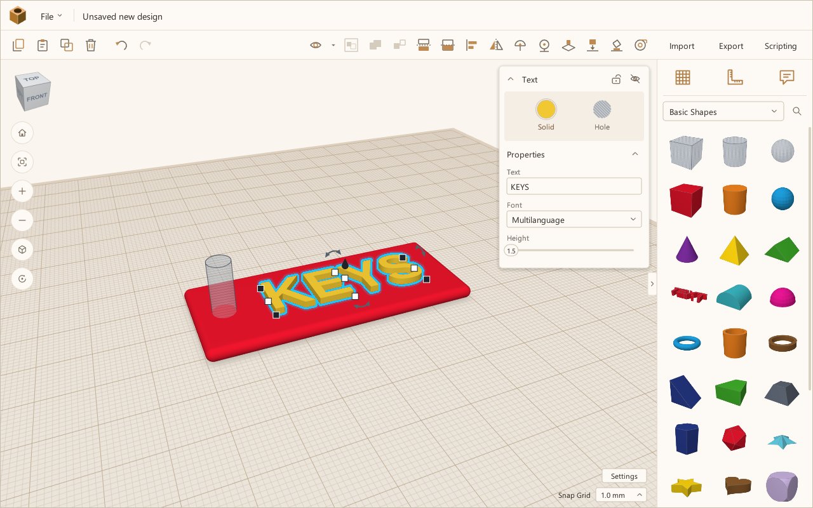
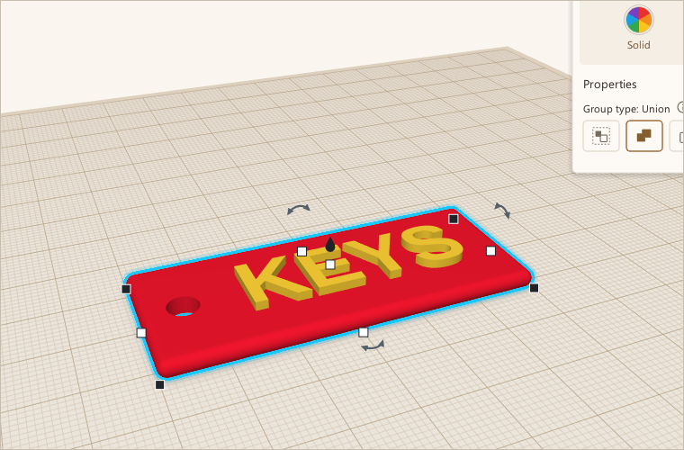
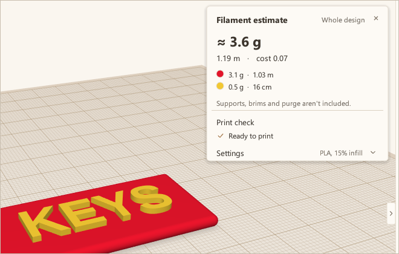
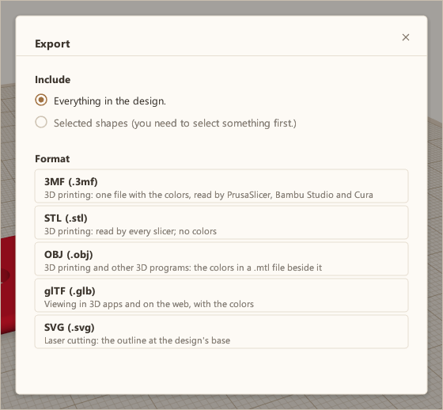

# 1. Getting started

[Contents](README.md) · Next: [Looking around](02-looking-around.md)

This chapter shows you round the window, then builds a small part, a key
tag, from an empty build plate to a file ready for your slicer. It takes
about ten minutes.

## Installing

ScottiCAD has no installer. Download the release for Windows or Linux
from the [releases page](https://github.com/scotticad/scotticad/releases/latest),
unpack it anywhere, and run `scotticad.exe` (Windows) or `./scotticad`
(Linux). The [README](../../README.md#download) has the details for each
system.

Nothing you make leaves your computer. There is no account, and designs
are ordinary files that you save where you like.

## The window

1. **File menu and design name.** New, Open, Save, Import, Export and the
   list of keyboard shortcuts. The name beside it is the design's file
   name.
2. **Editing buttons.** Copy, Paste, Duplicate, Delete, Undo and Redo.
3. **Tools.** Hide and show, group and ungroup, split, section view,
   align, mirror, place on surface, measure, construction plane, drop,
   lay flat and the filament estimate. Each has a tooltip with its name
   and key.
4. **Import, Export and Scripting.**
5. **View buttons.** The view cube, then Home, Fit, Zoom in, Zoom out,
   flat or perspective view, and the center of rotation.
   See [Looking around](02-looking-around.md).
6. **The build plate.** The grid you build on. It stands for your
   printer's bed: 200 × 200 mm unless you change it in
   [Settings](10-settings.md). The small squares are 1 mm and the heavier
   lines are 10 mm apart.
7. **Properties.** Appears when something is selected: its name, whether
   it is a solid or a hole, its colour and its own settings.
8. **The shape panel.** Shapes to drag onto the plate, a list of
   libraries to choose from, and a search. The three buttons above it
   are the construction plane, the ruler and notes.
9. **Settings and Snap Grid.** The snap grid is the step that shapes move
   and resize by.

## Moving the view

You will want to look at the part from different sides as you build it.

| To | Do this |
|---|---|
| Turn the view (orbit) | Drag with the **right** mouse button |
| Slide the view (pan) | Drag with the **middle** button, or hold **Shift** and drag with the right button |
| Zoom | Turn the mouse **wheel**, or press **+** and **-** |
| See everything | Press **F** |

The next chapter covers the view in full.

## A first part: a key tag

The tag is a flat plate with rounded corners, a hole for the key ring and
raised lettering.

### 1. Add a box

Drag the red **Box** from the shape panel onto the build plate. A
see-through copy follows the pointer until you let go.

The box is now selected: it has a blue outline and small square handles,
and the Properties panel has opened beside it.

### 2. Make it the size of a tag

In **Properties**, click each number, type a new one and press **Enter**:

- **Length** 60, **Width** 25, **Height** 3 (callout 1)
- Drag the **Radius** slider to 2 to round the edges (callout 2). To set a
  slider exactly, click the number on it and type.

Sizes are in millimetres. To work in inches, see
[Settings](10-settings.md).

### 3. Add a hole for the key ring

In ScottiCAD a hole is a shape that cuts away whatever it overlaps. The
striped grey shapes at the top of the panel are holes.

1. Drag the striped **Cylinder** onto an empty part of the plate, in
   front of the tag.
2. Click one of its black corner handles. Its size appears as two
   numbers on the plate.
3. Click each number, type **5** and press **Enter**.

Now put the hole in the tag. Drag it onto the left end of the tag, about
6 mm from the edge. Shapes move in 1 mm steps, so it is easy to place.
The hole is taller than the tag is thick, so it goes right through.

### 4. Center the hole across the tag

1. Click the tag, then hold **Shift** and click the hole, so both are
   selected.
2. Press **L** for the align tool. Dots appear round the two shapes.
3. Move the pointer over the middle dot on the short side. An orange
   preview shows where the shapes would go.
4. Click the dot. The two shapes line up across their middles, so the
   hole is centered in the tag's width.
5. Press **Esc** to put the tool away.

Both shapes moved a little to meet in the middle. To keep the tag where
it is, click the tag itself before clicking the dot: a shape you click
while aligning stays put and the others come to it.

### 5. Add the lettering

1. Drag **Text** (the red word in the panel) onto the top of the tag. New
   shapes land on whatever is under the pointer, so it sits on the tag's
   top face.
2. In Properties, click the **Text** box and type **KEYS**.
3. Drag the **Height** slider down to 1.5. This is how far the letters
   stand up.
4. Hold **Shift** and drag a black corner handle to shrink the word until
   it fits. Shift keeps its proportions.
5. Drag the word into place.
6. Click the coloured **Solid** disc in Properties and pick a colour.

### 6. Group the parts

Until now the tag, the hole and the lettering are three separate shapes.
Grouping joins them into one part and cuts the hole.

1. Press **Ctrl+A** to select everything.
2. Press **Ctrl+G**.

A group takes one colour. To keep the lettering's own colour, click the
**Solid** disc and turn **Multicolor** on.

Nothing is lost by grouping. **Ctrl+Shift+G** ungroups the tag back into
its three shapes whenever you want to change one.

### 7. Check it

Click the spool button at the right end of the toolbar. The panel
estimates the filament the part needs, and its **Print check** says
whether the part is ready to print.

[Getting ready to print](09-printing.md) explains what the check looks
for.

### 8. Save and export

- **Ctrl+S** saves the design as a `.scotticad` file, which you can open
  and change later.
- **Export** (top right) writes a file for your slicer. Choose **STL**,
  which every slicer reads, or **3MF** to keep the colours.

Open the exported file in your slicer and print it.

## What to read next

- [Shapes](03-shapes.md) shows everything in the shape panel.
- [Moving, sizing and turning](04-moving-and-sizing.md) covers the handles
  and exact sizes.
- [Holes and groups](05-holes-and-groups.md) explains the idea the whole
  program is built on.

---

[Contents](README.md) · Next: [Looking around](02-looking-around.md)
