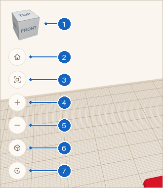
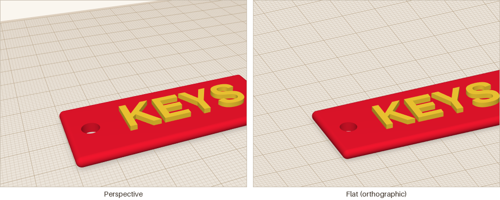
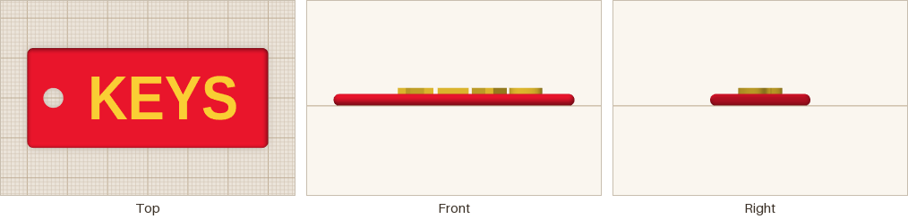
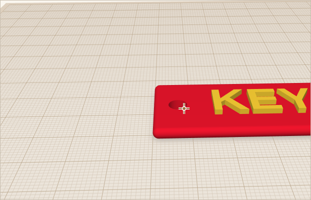

# 2. Looking around

[Contents](README.md) · Previous: [Getting started](01-getting-started.md) · Next: [Shapes](03-shapes.md)

The 3D view shows your design on the build plate. This chapter covers
turning, sliding and zooming it. None of it changes the design.

## With the mouse

| To | Do this |
|---|---|
| **Orbit**: turn the view round the design | Drag with the **right** button |
| **Pan**: slide the view sideways or up and down | Drag with the **middle** button, or hold **Shift** and drag with the right button |
| **Zoom** | Turn the **wheel** |

Zooming in goes toward the point under the pointer, so point at what you
want to see closer.

## The view buttons

The buttons at the top left of the view do the same things, and a few
more.

1. **The view cube** shows which way you are looking. Click a face (TOP,
   FRONT, and so on) to look straight at that side. Drag the cube to
   orbit.
2. **Home** goes back to the view a new design starts with.
3. **Fit** zooms so the selection fills the view, or the whole design
   when nothing is selected. Key: **F**.
4. **Zoom in**. Key: **+**.
5. **Zoom out**. Key: **-**.
6. **Flat or perspective view.** See below.
7. **Center of rotation.** See below.

## Perspective and flat views

In the **perspective** view, things farther away look smaller, as they do
to the eye. In the **flat** (orthographic) view they don't: lines that
are parallel in the part stay parallel on screen, which makes it easier
to judge whether things line up. Click button 6 to switch between them.

The flat view goes well with the view cube. Click a face of the cube and
you get a true top, front or side view of the part:

## The center of rotation

When you orbit, the view turns round one point: the center of rotation.
It starts near the middle of the build plate. If you are working on a
detail somewhere else, orbiting swings that detail out of sight.

To turn round the detail instead:

1. Click the **center of rotation** button (7).
2. Click the point to turn round: on a shape, on the build plate, or in
   empty space.

While you orbit, a small cross marks the center:

**Home** puts the center back where it started. If you would rather not see
the marker, turn off **Show center of rotation** in
[Settings](10-settings.md).

## Looking from below

Orbit far enough and you look up at the design from under the build
plate. The plate is see-through from below, so you can check the
underside of a part.

---

[Contents](README.md) · Previous: [Getting started](01-getting-started.md) · Next: [Shapes](03-shapes.md)
