# 3. Shapes

[Contents](README.md) · Previous: [Looking around](02-looking-around.md) · Next: [Moving, sizing and turning](04-moving-and-sizing.md)

Everything you build starts as a shape from the panel on the right.
This chapter covers finding shapes, placing them, and changing what they
are: their settings, their colour, and whether they are solid or a hole.
It ends with sketches: shapes you draw yourself.

## The shape panel

1. **Construction plane** tool
   ([Lining up and measuring](06-aligning-and-measuring.md))
2. **Ruler** tool
3. **Notes** tool
4. **Sketch tools**: Sketch, Revolve Sketch and Coil Sketch, for shapes
   you draw yourself ([Sketches](#sketches))
5. **Library list.** Chooses which set of shapes the panel shows.
6. **Search.**
7. **Hole shapes.** The striped grey shapes are ready-made holes.
8. **Solid shapes.**
9. **Hide the panel**, to give the view more room. Click again to bring it
   back.

Scroll the panel with the mouse wheel to see the rest of the shapes. Hold
the pointer over a shape to see its name.

### Libraries

Click the library list to choose a set of shapes.

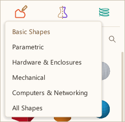

| Library | What is in it |
|---|---|
| **Basic Shapes** | Box, cylinder, sphere, cone, pyramid, roof, text, tube, torus, wedge, star, heart and more |
| **Parametric** | Shapes made from settings: a metric thread, a round-tooth gear, grids, a honeycomb, a fluted rod, a QR code |
| **Hardware & Enclosures** | Project boxes, standoffs, plates, vents, nuts and bolts, the holes for them, a keyhole slot, a bearing seat, port openings, a finishing washer and Gridfinity bins and baseplates |
| **Mechanical** | Gears (spur, helical, ring and bevel), a gear rack, a planetary gear set, a GT2 pulley, a spring, a pipe elbow, a bent tube, a knob, a hinge, and dovetail and pin joints |
| **Computers & Networking** | Simple models of computers and network gear, for diagrams and mock-ups |
| **All Shapes** | Everything |

[The shape library](13-shape-library.md) has a picture of every shape.

### Search

Click the magnifying glass and type. Search looks through every library,
and it knows everyday words as well as the shapes' names: *screw* finds
the bolt, *enclosure* finds the project box, *donut* finds the torus.

Press **Esc**, or click the ×, to go back to the library.

## Placing a shape

**Drag** a shape from the panel onto the build plate and let go. Or
**click** the shape in the panel, then click where you want it.

While you place it, the shape follows the surface under the pointer. Over
the build plate it sits on the plate. Over another shape it sits on that
shape's surface, which is the quick way to put a knob on top of a box.
Hold **C** to ignore other shapes and always place on the plate.

To change your mind while dragging, press **Esc** or drop the shape back
on the panel.

## Properties

Select a shape and the **Properties** panel opens at the top right of the
view.

1. **Fold the panel away**, leaving only its title. Click again to open
   it.
2. **The shape's name.** Click it to rename the shape: type a name and
   press **Enter**, or **Esc** to leave it as it was. Clear the name to
   go back to the shape's own name (Box, Cylinder).
3. **Lock.** A locked shape can't be moved or changed until you unlock
   it. Key: **Ctrl+L**.
4. **Hide.** Key: **Ctrl+H**. [Hiding shapes](04-moving-and-sizing.md#hiding-shapes)
   explains how to get it back.
5. **Solid.** Makes the shape a solid, and opens the colours.
6. **Hole.** Makes the shape a hole.
7. **Sliders** for the shape's settings. Drag one, or click the number on
   it and type an exact value.
8. **Number fields.** Click, type and press **Enter**; or use the small
   arrows to step up and down.

Each kind of shape has its own settings. A box has a corner radius; a
cylinder has a number of sides; a cone has a top radius; a spur gear
has a module, a number of teeth and a bore. Simple shapes such as the wedge have
none, and show only the top of the panel.

The settings stay with the shape. You can come back and change a gear's
tooth count after you have moved it, resized it or put it in a group.

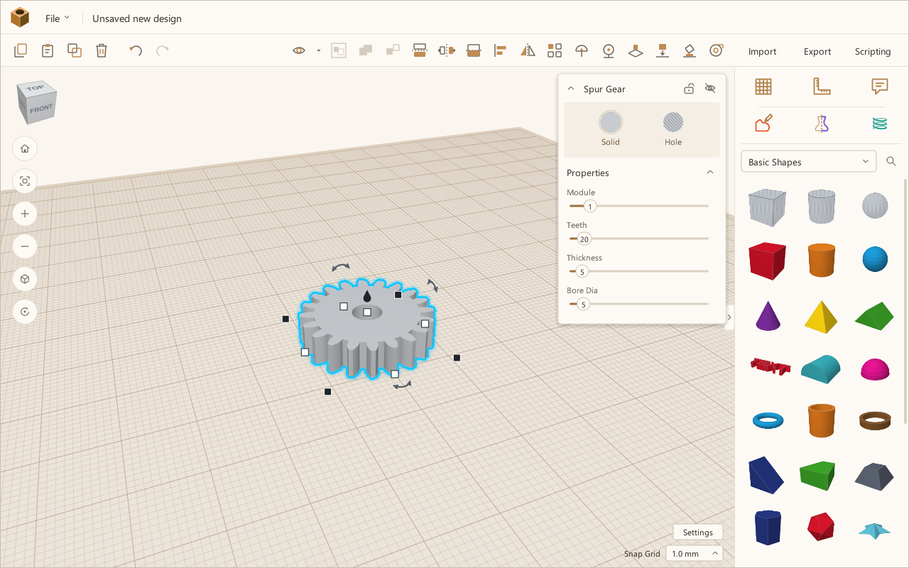

## Solid or hole

Every shape is either a **solid** or a **hole**. A solid is material. A
hole is the absence of it: when you group a hole with solids, it is cut
out of them. On its own a hole does nothing, and it isn't exported.

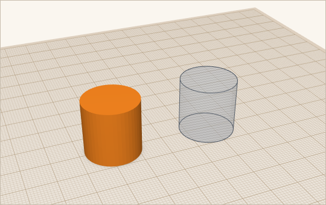

- Press **H** to make the selected shape a hole, and **S** to make it a
  solid again. Or click **Hole** and **Solid** in Properties.
- Any shape can be a hole, not only the striped ones in the panel. A hole
  in the shape of a star cuts a star-shaped pocket.

[Holes and groups](05-holes-and-groups.md) shows what holes do.

## Colour

Click the **Solid** disc in Properties to open the colours.

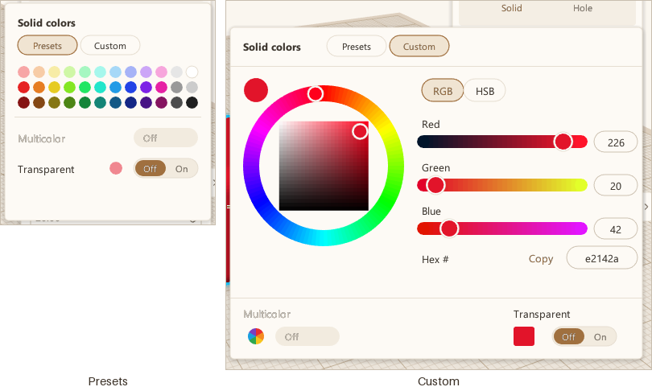

- **Presets** has a grid of ready-made colours. Click one.
- **Custom** has a colour wheel, sliders for red, green and blue (or hue,
  saturation and brightness: click **HSB**), and the colour's hex code,
  which you can type or copy.
- **Transparent** makes the shape see-through in the view, so you can
  see what is behind or inside it. Key: **Ctrl+T**. It doesn't change
  what is printed.
- **Multicolor** is for groups; see
  [Holes and groups](05-holes-and-groups.md#colour-in-a-group).

Colours are kept when you export to 3MF, OBJ or GLB. STL files have no
colour.

## Text

The **Text** shape in Basic Shapes makes raised lettering.

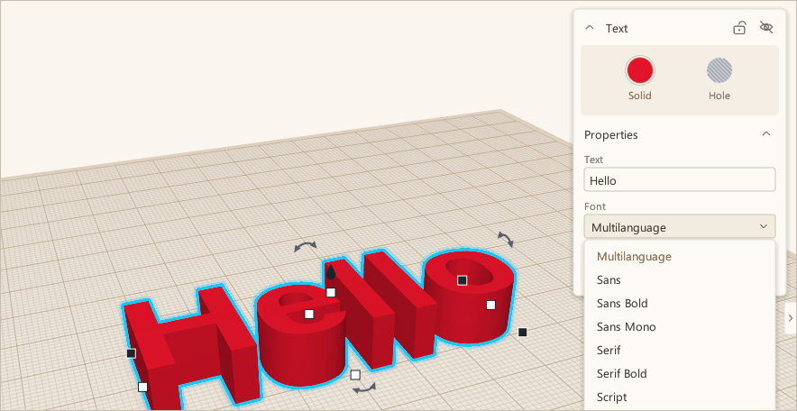

- **Text**: click the box and type. The shape changes as you type.
- **Font**: the list starts with seven fonts: Multilanguage, Sans, Sans
  Bold, Sans Mono, Serif, Serif Bold and Script. Multilanguage is built
  into ScottiCAD, so it looks the same on every computer; the other six
  use a matching font installed on your computer (Arial or Liberation
  Sans for Sans, for example). Below them, the list goes on with all the
  fonts installed on your computer.
- **Height**: how far the letters stand up, in millimetres.

Change the size of the lettering with the handles, like any shape. Hold
**Shift** as you drag a corner so the letters keep their proportions.

Text can be a hole, which engraves it. Put the hole text so it sinks a
little way into the top of a part and group the two.

## Sketches

When no shape in the panel has the outline you want, draw it. The three
sketch tools sit in their own row at the top of the shape panel, under
the Construction plane, Ruler and Notes tools, whichever library is
showing:

- **Sketch** stands your drawing straight up, like a biscuit cutter.
  It starts 10 mm tall; change the height as you would any shape's.
- **Revolve Sketch** spins your drawing round a centre line, for round
  things such as bowls, knobs, wheels and vases.
- **Coil Sketch** spins your drawing round a centre line too, rising as
  it turns, for springs, threads and spiral ramps.

Drag one onto the build plate (or click it, then click the plate) and
the sketch workspace opens: a flat
drawing board in place of the 3D view. The shape lands where you
dropped it when you click **Finish sketch**.

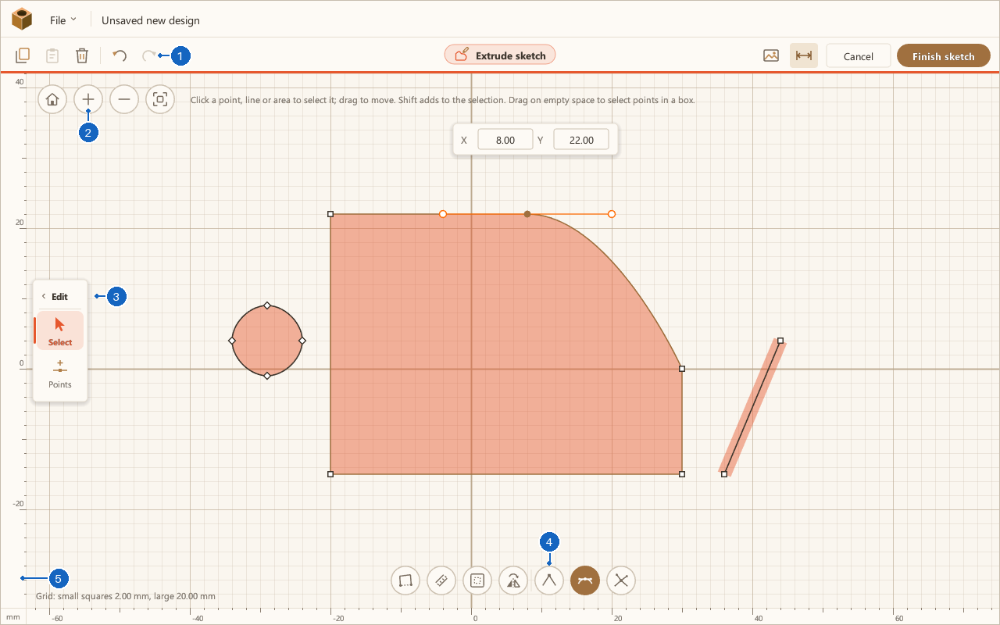

1. **The top bar**: Copy, Paste, Delete, Undo and Redo on the left; the
   kind of sketch in the middle, in its color (the bar's foot is that
   color too); **Picture to trace**, **Show dimensions**, **Cancel** and
   **Finish sketch** on the right. Cancel leaves everything as it was.
2. **The view buttons**: home, zoom in, zoom out, and fit the drawing.
3. **The modes**, down the left: **Pen** to draw and **Edit** to change
   what you drew. Inside either, its tools are listed by name, the one
   in use marked in the sketch's color, and the mode's name at the top
   (or **Esc**) takes you back out; while you are drawing a line, the
   first **Esc** ends it and a second leaves the Pen.
4. **The actions**, along the foot: open or close a path, its stroke,
   make it a hole, mirror and turn it, and what kind the selected points
   are.
5. **The rulers**, along the left and bottom edges, in the units set in
   Settings. A small marker on each shows where the pointer is.

On a **Sketch**'s board, the design's other shapes show in pale tan
where they are, seen from above, so you can draw to fit them. (A
revolve's or coil's board is a slice through its centre line, so it
shows none.)

Outside both modes, click a path (or inside it) to select the whole
shape, and drag to move it. Shift-click adds to the selection, and
dragging a box on empty space selects every shape it touches.

### Drawing with the Pen

Press **P** or click **Pen**, then pick a tool. Each click puts down a
point, and the points are joined in order. Click the first point again
to close the outline: the workspace then moves on to the Edit tools. To
leave a line open, click the green check, click its last point again,
or press **Enter**.

| Tool | Key | What it does |
|---|---|---|
| **Create line** | **1** | Sharp corners joined by straight lines |
| **Create Bézier curve** | **2** | Click for a corner; press and drag to pull out handles, which bend the path through the point |
| **Create smooth curve** | **3** | The path curves smoothly through every point you click. Four points on a square make a circle |
| **Clear** | | Throws away the path you are drawing, so you can start again. It does nothing when you aren't drawing |

You can change tool while you draw: the path carries on, so one outline
can have straight sides and curved ones. Lines you draw separately stay
separate paths, even where one starts or ends on the end of another: a
box drawn as four lines is four lines, which overlap at the corners. To
make one path of them, draw it in one go.

A line whose two ends meet closes, however they came together: drag its
end onto its start, type the end's position onto it, or nudge it there.
It then fills as an outline.

Points snap to the grid, which follows the **Snap Grid** setting. Hold
**Alt** to place a point off the grid, and **Shift** to draw at 15° steps.
While you draw, the length and angle of the next line show beside the
pointer. Press **Tab** to type the length instead: the point goes that
far along the line toward the pointer.

### Changing the drawing with Edit

Press **A** or click **Edit**:

| Tool | Key | What it does |
|---|---|---|
| **Select and move** | **V** | Click a point, a line between two points, or a whole area to select it, and drag to move it |
| **Add & remove points** | **4** | Click a path to add a point there without changing its shape (hold and drag to place it); click a point to remove it |

Shift-click to select more than one, or drag a box round points on
empty space. The arrow keys nudge the selection one grid step (ten with
**Shift**), and **Delete** removes the selected points.

With dimensions showing (**D**), a selected line shows its length and a
selected shape its width and height. Click one to type a new size: a
line's two ends move apart or together evenly, and a shape stretches
about its middle. **X** and **Y** move a single selected point to an
exact position.

A selected curve point shows its handles. Drag a handle to change the
bend; its offsets show as you drag. The three action buttons set what
kind the selected points are:

- **Make corner**: straight lines and a sharp corner, with no handles.
- **Make smooth**: the curve goes through without a kink. Its two
  handles are linked and the same length.
- **Split handles**: each handle moves on its own, for a corner between
  two curves. Drag a handle back onto its point to make it sharp.

**Ctrl+C** and **Ctrl+V** copy paths, also from one sketch to another.

### Tracing a picture

To copy the outline of a real part, photograph it straight down on a
sheet of paper (or scan it), with a ruler or a known size in the
picture, and trace it. Click **Picture to trace** (the picture button
beside Show dimensions) and pick a PNG or JPEG. It lies faded under the
drawing, and its panel opens:

- **Drag** on the board to move the picture.
- **Set scale**: click two points on the picture a known distance apart
  (two marks on the ruler), then type the real distance. The picture
  grows or shrinks about the first point, so what you trace comes out at
  its true size.
- **Level**: click two points that should be level (the part's straight
  edge, say). The picture turns to make them level.
- **Turn 90°** turns it a quarter turn; **Opacity %** fades it more or
  less; **Remove** takes it away; **Replace…** loads another.
- **Done** (or **Esc**, or picking a drawing tool) goes back to drawing,
  with the picture where you put it.

The picture is kept with the sketch, so it is there again when you edit
it, and saved in the design. It is never part of the shape, nor of
anything you export. A phone's photo is stood upright as it was held. A
photo taken at a slant makes the far end look smaller: shoot straight
down, from a little way off, or use a scanner.

### Areas, holes and strokes

A closed outline is a filled area. Areas that overlap join together, and
so does an outline drawn inside another: it leaves just the outside one.
An outline that crosses itself is filled everywhere it goes round, so a
five-pointed star drawn in one stroke is solid, middle and all.

For a hole, select the outline and click **Make hole** (**H**). It is
drawn dashed, and what it covers is cut out of the rest of the drawing,
whichever outlines it overlaps: an outline inside another makes a ring,
one across an edge cuts a notch. A line can be a hole too, for a slot or
a groove. Click **Make hole** again to make it solid again. On a revolve
or coil, a hole in the profile makes the part hollow.

**Open path** (**O**) opens a selected closed path: where a single line
is selected, that line is the one left out. **Close path** joins an
open path's ends.

A path can also be a stroke, a line of a set width, instead of the area
it encloses. Select it, click **Stroke settings**, and switch the
stroke on. An open path always has a stroke, 2 mm wide to start with.

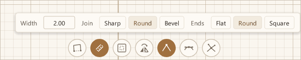

- **Width**: how wide the stroke is.
- **Alignment**, for a closed path: **Center** on the path, all
  **Inside** it, or all **Outside** it. Outside a shape's outline, for
  example, makes a rim that fits round the shape.
- **Join**: the corners, **Sharp**, **Round** or **Bevel** (cut off
  square, just where a Round corner would reach).
- **Ends**, for an open path: **Flat**, **Round**, or **Square** (half the
  width longer).

### Mirror and turn

Select one or more paths and click **Mirror and turn** (**M**):

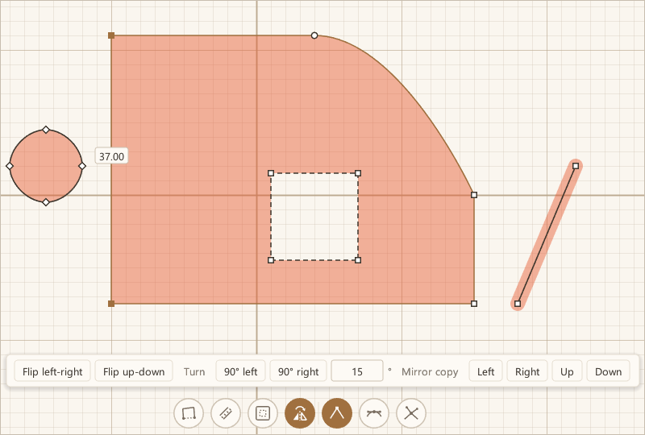

- **Flip left-right** and **Flip up-down** flip the selection where it
  is, about its middle.
- **Turn**: **90° left** and **90° right** turn it a quarter turn about
  its middle. Type an angle in the box to turn it by that much
  (anticlockwise; a minus angle turns it clockwise).
- **Mirror copy**: **Left**, **Right**, **Up** or **Down** adds a mirror
  image of the selection on that side, touching it. Draw half of a
  symmetric part, mirror it, and the two halves join into the whole. The
  copy is selected, so it can be mirrored again for a quarter-drawn part.

On a revolve or coil board, anything a flip, turn or copy would put right
of the centre line moves back left of it.

### Extruded sketches

In Properties, an extruded sketch has:

- **Quality**: how many straight pieces each curve is cut into.
- **Top Scale** and **Base Scale**: the top and the bottom as a
  percentage of the drawing's size, for a taper. At 0 that end comes to
  a point.
- **Twist**: how far the top turns, in degrees (anticlockwise seen from
  above). **Twist Mode** says how it turns:
  - **Steps**: in layers, set by **Twist Steps**, how many times the turn
    is broken along the way. At 0 the top is joined straight to the
    bottom; 5 makes six layers.
  - **Smooth**: in 96 fine layers, whatever Twist Steps says, for a
    twist with no visible steps.

### Revolve sketches

A revolve sketch shows a dashed centre line, two thirds of the way
across the board; the third right of it is blanked out. Draw half the
profile to the left of it: whatever is to the right is left out. The
line stays put as you zoom, and the board scrolls up and down. The
centre line becomes the shape's upright axis, and the drawing's
horizontal axis is the build plate: a profile drawn starting 5 mm up
stands 5 mm above the plate.

A card in the blanked third, at the top, shows the shape your drawing
makes, updated as you draw. Drag in it to turn it, and use its buttons
(or the mouse wheel over it) to reset the view or zoom. Coil sketches
have it too.

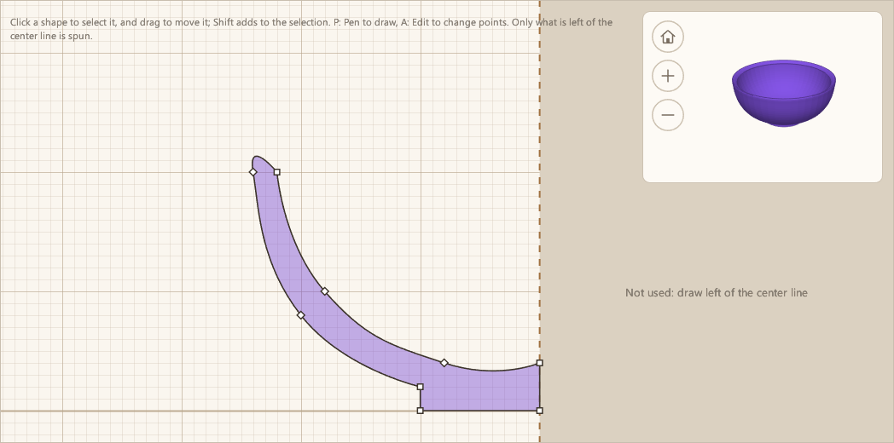

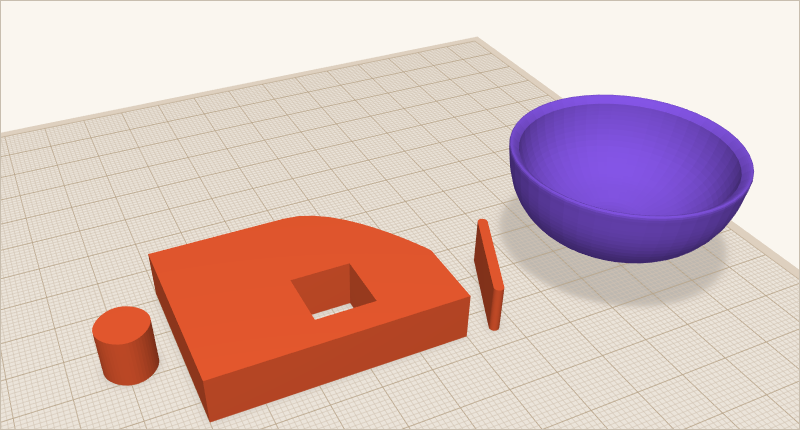

In Properties, **Sweep** turns it less than a full circle (180 makes a
half), and **Start** sets where the sweep begins: at 0 it starts at the
back (+Y) and runs anticlockwise seen from above. **Sides** is how many
steps the sweep is cut into, so a half turn with 48 sides is as smooth
as a full turn with 96. **Quality** is how many straight pieces each
curve in the drawing is cut into.

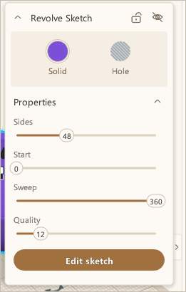

### Coil sketches

A coil sketch is drawn like a revolve sketch: half the profile, left of
the dashed centre line. The coil spins it round that line, rising as it
goes, like the wire of a spring. A small circle a little way left of
the line makes a spring; a triangle against a cylinder's side makes a
thread.

In Properties:

- **Turns**: how many times it goes round. Quarter turns are allowed.
- **Pitch**: how far it rises in one turn. A pitch smaller than the
  profile's height would make each turn run into the next, so the
  pitch is never less than the profile is tall.
- **Sides a Turn**: how many steps each turn is cut into.
- **Start** and **Quality**, as for a revolve sketch.

The profile is kept a hair (0.05 mm) clear of the centre line, so one
turn can't meet the next in the middle. For a screw, put a cylinder up
the middle of the coil.

### Changing a sketch later

Double-click a sketch, or click **Edit sketch** in its Properties, to
open its drawing again. If you have moved, turned or resized the shape,
it keeps that: the parts of the drawing you don't change stay where
they are.

A sketch is a shape like any other. It can be a hole, be grouped, take
a colour, or be cut with Split.

Things to know:

- Finish sketch builds nothing from a drawing with nothing to fill: an empty
  board, or for a revolve nothing left of the centre line. The
  workspace stays open and says so.
- The workspace has its own undo. When you click Finish sketch, the whole change
  is one step in the design's undo. Undo while you are drawing a path
  takes back its last point, and you carry on drawing from the one
  before.
- Import, New and Open wait until you finish or cancel the sketch.
- On a revolve or coil sketch nothing goes right of the centre line: a
  point typed or pasted there moves left to it.
- A design with a sketch in it can't be opened by a ScottiCAD from
  before sketches.

---

[Contents](README.md) · Previous: [Looking around](02-looking-around.md) · Next: [Moving, sizing and turning](04-moving-and-sizing.md)
