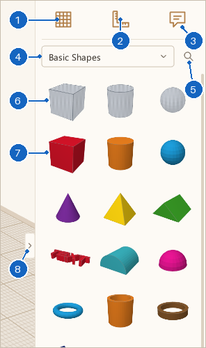
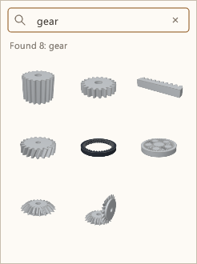
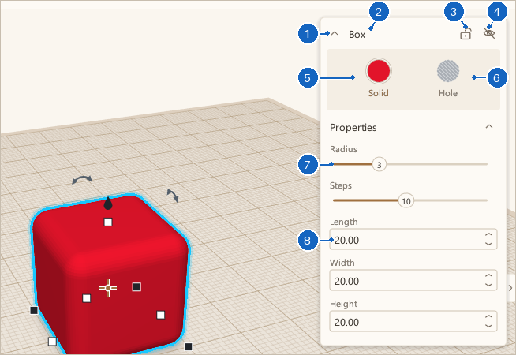

# 3. Shapes

[Contents](README.md) · Previous: [Looking around](02-looking-around.md) · Next: [Moving, sizing and turning](04-moving-and-sizing.md)

Everything you build starts as a shape from the panel on the right.
This chapter covers finding shapes, placing them, and changing what they
are: their settings, their colour, and whether they are solid or a hole.

## The shape panel

1. **Construction plane** tool
   ([Lining up and measuring](06-aligning-and-measuring.md))
2. **Ruler** tool
3. **Notes** tool
4. **Library list.** Chooses which set of shapes the panel shows.
5. **Search.**
6. **Hole shapes.** The striped grey shapes are ready-made holes.
7. **Solid shapes.**
8. **Hide the panel**, to give the view more room. Click again to bring it
   back.

Scroll the panel with the mouse wheel to see the rest of the shapes. Hold
the pointer over a shape to see its name.

### Libraries

Click the library list to choose a set of shapes.

| Library | What is in it |
|---|---|
| **Basic Shapes** | Box, cylinder, sphere, cone, pyramid, roof, text, tube, torus, wedge, star, heart and more |
| **Parametric** | Shapes made from settings: a metric thread, a round-tooth gear, grids, a honeycomb, a fluted rod, a QR code |
| **Hardware & Enclosures** | Project boxes, standoffs, plates, vents, nuts and bolts, the holes for them, a keyhole slot and a bearing seat |
| **Mechanical** | Gears (spur, helical, ring and bevel), a gear rack, a planetary gear set, a GT2 pulley, a spring, a pipe elbow, a bent tube, a knob, a hinge, and dovetail and pin joints |
| **Computers & Networking** | Simple models of computers and network gear, for diagrams and mock-ups |
| **All Shapes** | Everything |

[The shape library](13-shape-library.md) has a picture of every shape.

### Search

Click the magnifying glass and type. Search looks through every library,
and it knows everyday words as well as the shapes' names: *screw* finds
the bolt, *enclosure* finds the project box, *donut* finds the torus.

Press **Esc**, or click the ×, to go back to the library.

## Placing a shape

**Drag** a shape from the panel onto the build plate and let go. Or
**click** the shape in the panel, then click where you want it.

While you place it, the shape follows the surface under the pointer. Over
the build plate it sits on the plate. Over another shape it sits on that
shape's surface, which is the quick way to put a knob on top of a box.
Hold **C** to ignore other shapes and always place on the plate.

To change your mind while dragging, press **Esc** or drop the shape back
on the panel.

## Properties

Select a shape and the **Properties** panel opens at the top right of the
view.

1. **Fold the panel away**, leaving only its title. Click again to open
   it.
2. **The shape's name.** Click it to rename the shape: type a name and
   press **Enter**, or **Esc** to leave it as it was. Clear the name to
   go back to the shape's own name (Box, Cylinder).
3. **Lock.** A locked shape can't be moved or changed until you unlock
   it. Key: **Ctrl+L**.
4. **Hide.** Key: **Ctrl+H**. [Hiding shapes](04-moving-and-sizing.md#hiding-shapes)
   explains how to get it back.
5. **Solid.** Makes the shape a solid, and opens the colours.
6. **Hole.** Makes the shape a hole.
7. **Sliders** for the shape's settings. Drag one, or click the number on
   it and type an exact value.
8. **Number fields.** Click, type and press **Enter**; or use the small
   arrows to step up and down.

Each kind of shape has its own settings. A box has a corner radius; a
cylinder has a number of sides; a cone has a top radius; a spur gear
has a module, a number of teeth and a bore. Simple shapes such as the wedge have
none, and show only the top of the panel.

The settings stay with the shape. You can come back and change a gear's
tooth count after you have moved it, resized it or put it in a group.

## Solid or hole

Every shape is either a **solid** or a **hole**. A solid is material. A
hole is the absence of it: when you group a hole with solids, it is cut
out of them. On its own a hole does nothing, and it isn't exported.

- Press **H** to make the selected shape a hole, and **S** to make it a
  solid again. Or click **Hole** and **Solid** in Properties.
- Any shape can be a hole, not only the striped ones in the panel. A hole
  in the shape of a star cuts a star-shaped pocket.

[Holes and groups](05-holes-and-groups.md) shows what holes do.

## Colour

Click the **Solid** disc in Properties to open the colours.

- **Presets** has a grid of ready-made colours. Click one.
- **Custom** has a colour wheel, sliders for red, green and blue (or hue,
  saturation and brightness: click **HSB**), and the colour's hex code,
  which you can type or copy.
- **Transparent** makes the shape see-through in the view, so you can
  see what is behind or inside it. Key: **Ctrl+T**. It doesn't change
  what is printed.
- **Multicolor** is for groups; see
  [Holes and groups](05-holes-and-groups.md#colour-in-a-group).

Colours are kept when you export to 3MF, OBJ or GLB. STL files have no
colour.

## Text

The **Text** shape in Basic Shapes makes raised lettering.

- **Text**: click the box and type. The shape changes as you type.
- **Font**: the list starts with seven fonts: Multilanguage, Sans, Sans
  Bold, Sans Mono, Serif, Serif Bold and Script. Multilanguage is built
  into ScottiCAD, so it looks the same on every computer; the other six
  use a matching font installed on your computer (Arial or Liberation
  Sans for Sans, for example). Below them, the list goes on with all the
  fonts installed on your computer.
- **Height**: how far the letters stand up, in millimetres.

Change the size of the lettering with the handles, like any shape. Hold
**Shift** as you drag a corner so the letters keep their proportions.

Text can be a hole, which engraves it. Put the hole text so it sinks a
little way into the top of a part and group the two.

---

[Contents](README.md) · Previous: [Looking around](02-looking-around.md) · Next: [Moving, sizing and turning](04-moving-and-sizing.md)
