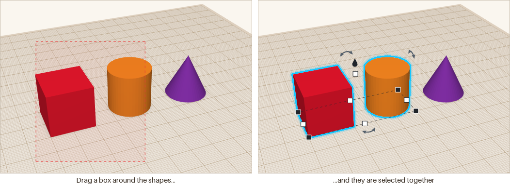
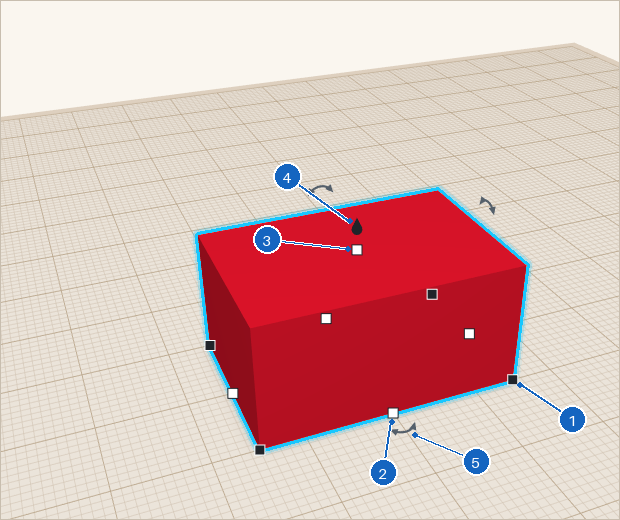
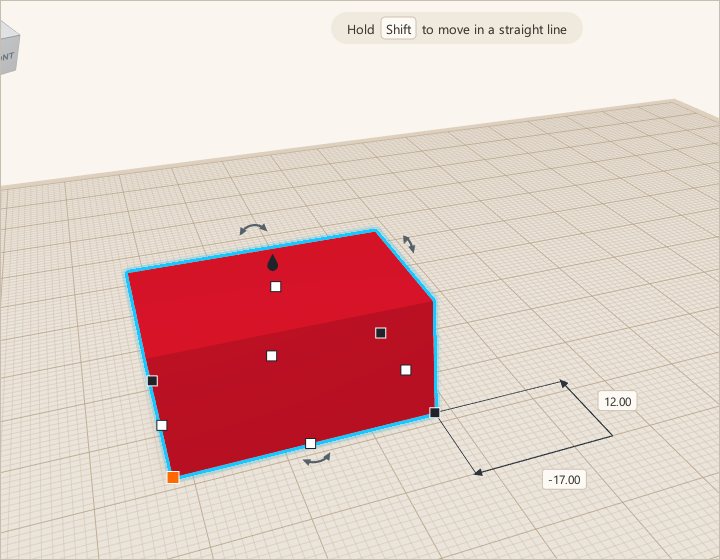
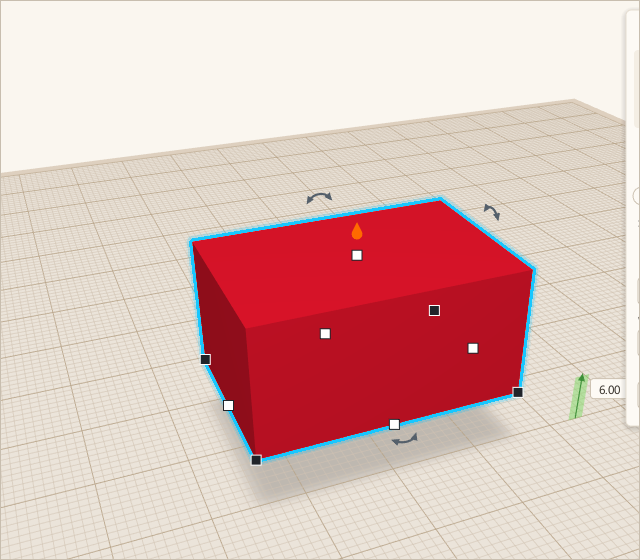
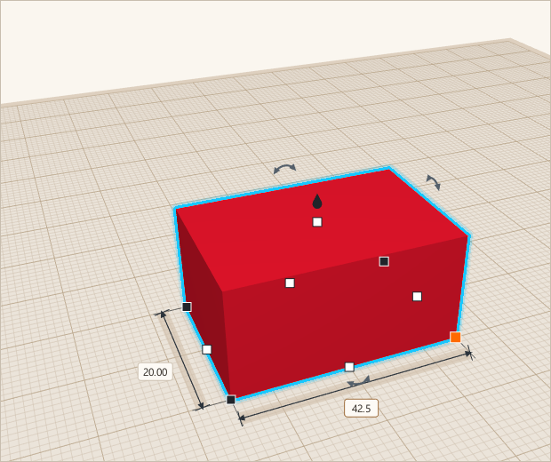
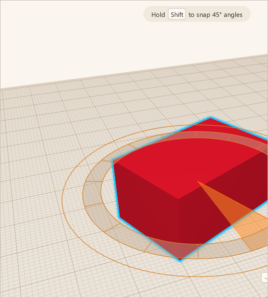
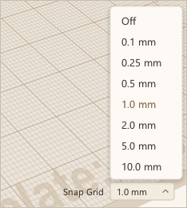
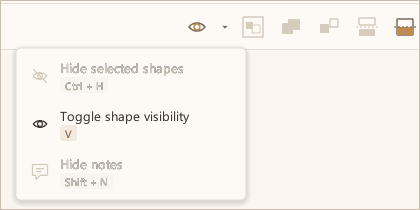
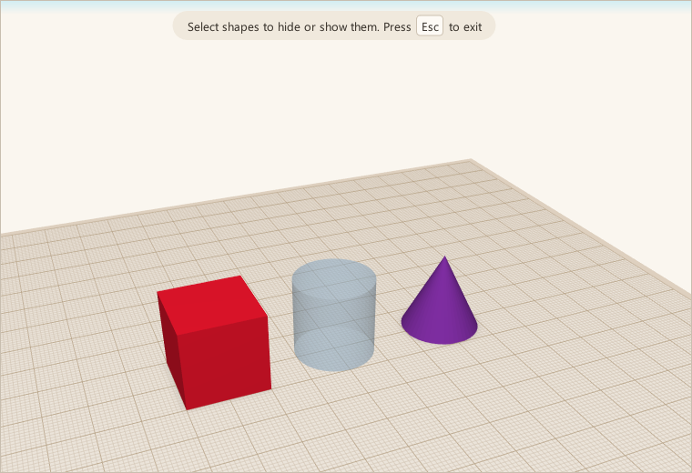

# 4. Moving, sizing and turning

[Contents](README.md) · Previous: [Shapes](03-shapes.md) · Next: [Holes and groups](05-holes-and-groups.md)

This chapter covers selecting shapes and changing where they are, how
big they are and which way they face, by dragging or by typing exact
numbers.

## Selecting

| To | Do this |
|---|---|
| Select a shape | Click it |
| Add a shape to the selection, or take it out | Hold **Shift** and click it |
| Select several shapes at once | Drag a box round them, starting on an empty part of the view |
| Select everything | **Ctrl+A** |
| Select nothing | Click an empty part of the view, or press **Esc** |

Selected shapes have a blue outline. A shape under the pointer gets a
thinner outline, to show what a click would pick.

With several shapes selected, the handles go round all of them, and
moving, sizing and turning act on them together.

## The handles

A selected shape has handles for everything you can do to it with the
mouse.

1. **Corner handles** (black squares, one at each corner of the base).
   Drag to change the length and the width together.
2. **Edge handles** (white squares, in the middle of each side of the
   base). Drag to change the length or the width alone.
3. **Top handle** (white square on top). Drag to change the height.
4. **Lift handle** (the black cone above the top). Drag to raise the
   shape off the plate or lower it.
5. **Turn handles** (the three curved arrows). Drag one to turn the shape
   about one axis.

Keys that change a drag:

| While | Hold | To |
|---|---|---|
| Sizing | **Shift** | Keep the shape's proportions |
| Sizing | **Alt** | Size about the middle, so opposite sides move together |
| Moving | **Shift** | Move in a straight line along one axis |
| Moving | **Alt** | Leave the shape where it is and drag a copy |
| Turning | **Shift** | Turn in steps of 45° |

A hint at the top of the view reminds you of the key for what you are
doing. **Esc** cancels a drag and puts the shape back.

## Moving

Drag a shape to slide it across the build plate. Two numbers show how far
it has moved along each direction.

To move a shape up or down, drag its **lift handle**. The number is its
height above the plate.

From the keyboard:

| Keys | Move |
|---|---|
| **Arrow keys** | One step of the snap grid across the plate |
| **Shift + arrow keys** | Ten steps |
| **Ctrl+Up**, **Ctrl+Down** | One step up or down (with **Shift**, ten) |
| **D** | Drop the shape straight down onto the plate |

The arrow keys follow the view: the up arrow moves the shape away from
you, whichever way you are looking.

## Sizing with exact numbers

Dragging a handle is quick. Typing is exact.

1. Click a handle (don't drag it). The sizes it controls appear as
   numbers beside the shape.
2. Click a number. It becomes a box you can type in.
3. Type the size and press **Enter**. **Esc** leaves it as it was.
   **Tab** keeps what you typed and moves on to the next number
   (**Shift+Tab** to the one before).

The top handle shows the height, and the lift handle shows how far the
shape is above the plate. Both can be typed the same way.

What you can type:

- A plain number, in the design's units: `42.5`
- A fraction, handy in inches: `1/8`, `1 1/2`
- A number with its unit, whatever the design's units are: `25mm`,
  `2.5cm`, `1in`, `3/4"`

Many shapes also have their sizes in the Properties panel (a box has
Length, Width and Height), which is often the quickest place to type
them.

## Turning

Drag one of the three turn handles. A protractor appears, and the angle
is shown as you drag.

- Keep the pointer **inside** the protractor to turn in steps of 22.5°.
- Move it **outside** the protractor to turn in steps of 1°.
- Hold **Shift** for steps of 45°.

For an exact angle, let go and then click the angle shown beside the
protractor, type the angle you want and press **Enter**. The protractor
stays up, with its angle ready to type, until you select something else
or make another change.

Each handle turns the shape about a different axis: one spins it flat on
the plate, the other two tip it over forwards or sideways. After tipping
a shape, press **D** to drop it back onto the plate.

To put a particular face down on the plate, use **Lay flat**
([Lining up and measuring](06-aligning-and-measuring.md#lay-flat)).

## The snap grid

Shapes move and resize in steps. The step is the **Snap Grid**, at the
bottom right of the view. Click it to choose another.

- In millimetres: Off, 0.1, 0.25, 0.5, 1, 2, 5 or 10 mm.
- In inches: Off, or a fraction from 1/64 to 1 inch.

A coarse step such as 1 mm keeps parts on round numbers. Choose a finer
one, or **Off**, for fine adjustments. Numbers you type are never
rounded to the grid.

## Copying

| Keys | What it does |
|---|---|
| **Ctrl+D** | Duplicate: makes a copy exactly on top of the original and selects it, ready to resize, change or move |
| **Ctrl+C**, **Ctrl+V** | Copy and paste. The copy appears a little to one side |
| **Ctrl+Shift+V** | Paste in place: the copy appears exactly where the original is |
| **Ctrl+X** | Cut |
| **Alt + drag** | Drag a copy out of a shape |
| **Delete** | Delete the selection |

Duplicate leaves the copy in place on purpose, so the two shapes stay
lined up while you change one of them. To make a standoff, for example,
duplicate a cylinder, make the copy narrower, and turn it into a
[hole](05-holes-and-groups.md): the hole is already centered in the
post.

To make a row of copies, duplicate a shape, move the copy, then press
**Ctrl+D** again: each new copy repeats the move you gave the one
before.

Copy and paste also work between two ScottiCAD windows.

## Undo

**Ctrl+Z** undoes the last change and **Ctrl+Y** redoes it. ScottiCAD
remembers the last 500 changes, so you can try things freely.

## Hiding shapes

When a shape is in the way, hide it. A hidden shape is still part of the
design; you just can't see or select it.

- **Ctrl+H** hides the selected shapes.
- **Ctrl+Shift+H** shows everything again. So does the eye button in the
  toolbar, which is highlighted while anything is hidden.

The small arrow beside the eye button opens a menu: **Hide selected
shapes**, **Toggle shape visibility** and **Hide notes**.

**Toggle shape visibility** (key: **V**) is for hiding and showing
several shapes. While it is on, hidden shapes appear as pale ghosts.
Click any shape to hide it, or a ghost to show it again. Press **Esc**
when you are done.

## Locking shapes

**Ctrl+L**, or the padlock in Properties, locks the selected shapes. A
locked shape can't be moved or changed by accident. Select it and press
**Ctrl+L** again to unlock it.

---

[Contents](README.md) · Previous: [Shapes](03-shapes.md) · Next: [Holes and groups](05-holes-and-groups.md)
