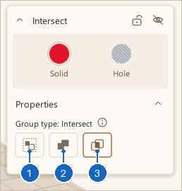
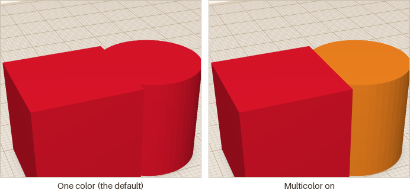

# 5. Holes and groups

[Contents](README.md) · Previous: [Moving, sizing and turning](04-moving-and-sizing.md) · Next: [Lining up and measuring](06-aligning-and-measuring.md)

Shapes on their own only go so far. Real parts are made by **grouping**:
joining shapes together, and cutting holes out of them. This is the one
idea the rest of ScottiCAD is built round.

## Cutting a hole

1. Put a solid shape on the plate.
2. Add a **hole** shape and move it so it overlaps the solid where you
   want material removed. (Any shape becomes a hole when you select it
   and press **H**.)
3. Select both and press **Ctrl+G**, or click the **Union Group** button
   in the toolbar.

The result is one part. The hole only removes material where it overlaps
a solid, so make it at least as deep as the cut you want. A hole that
sticks out of the top or bottom of the solid does no harm.

A group can hold as many solids and holes as you like. Every solid is
joined, and every hole is cut from the result.

## Nothing is lost

A group keeps its shapes inside it. **Ctrl+Shift+G** (or the **Ungroup**
button) takes it apart again, giving back every shape as it was, with its
own size, colour and settings. So when a hole turns out to be in the
wrong place, ungroup, move it, and group again.

Combining big or detailed shapes can take a moment. ScottiCAD does it in
the background and shows "Combining shapes…" at the top of the view; you
can keep working meanwhile.

## The three kinds of group

A group can combine its shapes in three ways. Select a group and choose
in Properties:

1. **Bundle** keeps the shapes separate. They move, turn and resize as
   one, but nothing is joined or cut, and each keeps its own colour. Use
   it to keep related parts together. Key: **Ctrl+B**.
2. **Union** joins the solids into one part and cuts the holes out of
   it. This is the usual kind. Key: **Ctrl+G**.
3. **Intersect** keeps only the material that every shape shares: the
   place where they all overlap.

You can switch a group between the three at any time.

## Groups inside groups

A group is a shape like any other, so it can go in another group. This
is how more complicated parts are built up:

- Make a detail, such as a mounting boss with its screw hole, as one
  group. Then copy it to each corner and group the copies with the
  plate.
- Holes inside a group only cut that group. They don't reach out and cut
  the shapes around it.
- A whole group can be a hole. Select it and press **H**. This is how to
  cut a shape that itself needed grouping to make, such as a cross made
  of two boxes.

## Colour in a group

A union is a single part, so by default it takes a single colour. Click
the **Solid** disc to choose it.

To keep each shape's own colour on the surfaces it contributed, turn
**Multicolor** on in the colour picker.

A multicolour group exports to 3MF as one part per colour, ready for a
multi-material printer, or for a filament change part way up. A bundle
always keeps its shapes' colours, since nothing in it is joined.

## Tips

- **Overlap, don't just touch.** Let solids that should join overlap a
  little. Shapes that only touch along a face or an edge may print as
  separate pieces.
- **Make holes longer than they need to be.** A hole exactly as deep as
  the wall can leave a paper-thin skin. Let it poke through.
- **Group in stages.** Build each detail as its own small group, check
  it, then group the details together. A mistake is easier to find, and
  ungrouping takes you back one stage at a time.

---

[Contents](README.md) · Previous: [Moving, sizing and turning](04-moving-and-sizing.md) · Next: [Lining up and measuring](06-aligning-and-measuring.md)
