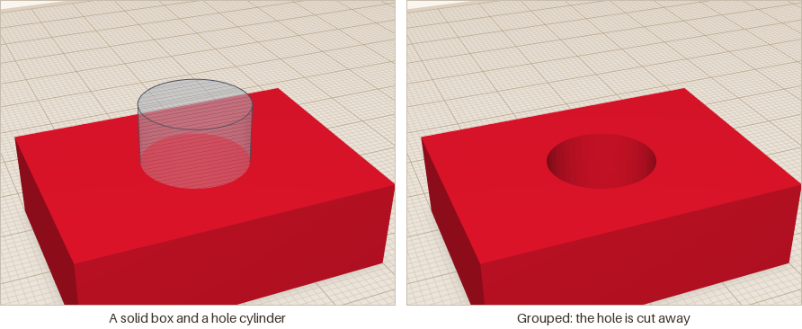
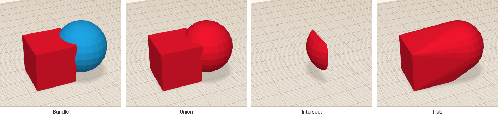
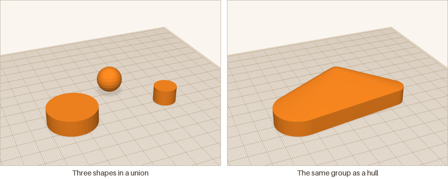
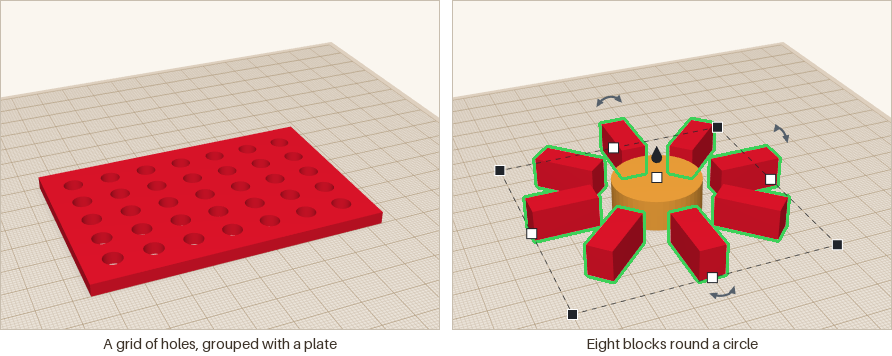
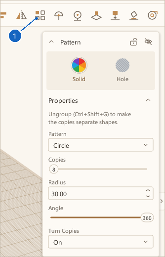

# 5. Holes and groups

[Contents](README.md) · Previous: [Moving, sizing and turning](04-moving-and-sizing.md) · Next: [Lining up and measuring](06-aligning-and-measuring.md)

Shapes on their own only go so far. Real parts are made by **grouping**:
joining shapes together, and cutting holes out of them. This is the one
idea the rest of ScottiCAD is built round.

## Cutting a hole

1. Put a solid shape on the plate.
2. Add a **hole** shape and move it so it overlaps the solid where you
   want material removed. (Any shape becomes a hole when you select it
   and press **H**.)
3. Select both and press **Ctrl+G**, or click the **Union Group** button
   in the toolbar.

The result is one part. The hole only removes material where it overlaps
a solid, so make it at least as deep as the cut you want. A hole that
sticks out of the top or bottom of the solid does no harm.

A group can hold as many solids and holes as you like. Every solid is
joined, and every hole is cut from the result.

## Nothing is lost

A group keeps its shapes inside it. **Ctrl+Shift+G** (or the **Ungroup**
button) takes it apart again, giving back every shape as it was, with its
own size, colour and settings. So when a hole turns out to be in the
wrong place, ungroup, move it, and group again.

Combining big or detailed shapes can take a moment. ScottiCAD does it in
the background and shows "Combining shapes…" at the top of the view; you
can keep working meanwhile.

## The four kinds of group

A group can combine its shapes in four ways. Select a group and choose
in Properties:

1. **Bundle** keeps the shapes separate. They move, turn and resize as
   one, but nothing is joined or cut, and each keeps its own colour. Use
   it to keep related parts together. Key: **Ctrl+B**.
2. **Union** joins the solids into one part and cuts the holes out of
   it. This is the usual kind. Key: **Ctrl+G**.
3. **Intersect** keeps only the material that every shape shares: the
   place where they all overlap.
4. **Hull** wraps the solids in one skin with no dents, like cling film
   stretched round them, and fills everything inside. See below.

You can switch a group between the four at any time.

## Hull

A hull is the smallest shape with no dents that holds all the group's
solids. The shapes don't need to touch: the hull fills the space
between them.

To make one, group the shapes (**Ctrl+G**), then click **Hull** in
Properties. Some things it is good for:

- **Arms and links.** Two cylinders apart make a lever arm with round
  ends; three make a triangular bracket with round corners.
- **Plates with round corners.** A small cylinder at each corner.
- **Adapters.** A wide shape below and a narrow one above make a smooth
  taper between them.
- **Soft, rounded bodies.** A few spheres of different sizes.

Like any group, a hull keeps its shapes inside it. Ungroup gives them
back, and moving a shape inside the group reshapes the hull. To keep the
shapes as well as their hull, duplicate them first (**Ctrl+D**) and
group the copies.

- **A hull never has a dent.** The hull of an L-shaped part fills in the
  L. For a part with a hollow or an inside corner, hull its pieces
  separately and group those, or cut the hollow out with a hole.
- **Holes are cut afterwards.** The solids are wrapped first, then the
  group's holes are cut from the result, as in a union. So a hole can
  cut the skin stretched between two shapes.
- **One colour.** The skin belongs to no one shape, so a hull is a single
  colour, even with Multicolor on.
- **Round shapes stay as smooth as they were.** The hull of two 48-sided
  cylinders has 48-sided ends. Raise their **Sides** for a smoother hull.

An earlier ScottiCAD doesn't know hull groups, and shows one as a union
of its shapes.

## Patterns

A pattern shows a shape many times over: in rows and columns, or round a
circle. It is for a grid of vent holes, a ring of bolt holes, a row of
pegs, the teeth round a knob.

Select a shape (or several) and click **Pattern** in the toolbar, or
press **P**. You get a row of three, and Properties shows the pattern's
settings:

**Pattern** chooses between the two layouts.

- **Grid**: **Columns** and **Rows** are how many, and **Column
  Spacing** and **Row Spacing** are the distance from one copy to the
  next (centre to centre, not the gap between them). One row is a
  straight line of copies. **Stagger Rows** moves every second row half
  a column along, the way bricks are laid, which packs round holes
  closer.
- **Circle**: **Copies** is how many and **Radius** how far they are
  from the centre. **Angle** is how much of the circle they are spread
  over: at 360° they share the full turn evenly, and at anything less
  there is a copy at each end of the arc. With **Turn Copies** on, each
  copy is turned to face the same way out from the centre; off, they all
  keep the direction of the first.

The shape you started with doesn't move: it is the first copy. Columns
run to its right and rows away from you, and a circle's centre is one
radius to its left. To send the copies the other way, type a negative
spacing, or turn the whole pattern afterwards.

A pattern is a kind of group. It holds one shape and the numbers, not
the copies, which is what makes it useful:

- **Change the numbers at any time**, and the copies follow.
- **Holes stay holes.** A pattern of a hole is a set of holes. Group it
  with a plate (**Ctrl+G**) and they are all cut at once. A pattern's
  settings are still there when you ungroup the plate.
- **It keeps its parts separate**, as a bundle does: each copy keeps its
  colours, and copies that overlap aren't joined until the pattern is
  grouped with something.
- **Move, turn and resize it** like any shape. Stretching a pattern
  stretches its spacing along with its copies.
- **A pattern can go in a pattern.** A row of three, repeated round a
  circle, for example.

**Ungroup** (**Ctrl+Shift+G**) turns the copies into ordinary shapes,
each of which can then be moved or changed on its own. Do this when one
copy needs to be different, or left out. The pattern's settings are gone
after that (Undo brings them back).

A pattern has at most 50 columns and 50 rows, or 200 copies round a
circle. A pattern can hold other patterns, which multiplies the copies:
all told it shows at most 20,000 shapes, and a setting that would pass
that is refused. A great many copies of a detailed shape take a while
to cut from a part.

An earlier ScottiCAD doesn't know patterns, and shows only the first
copy. It keeps the pattern's numbers if it saves the design.

## Groups inside groups

A group is a shape like any other, so it can go in another group. This
is how more complicated parts are built up:

- Make a detail, such as a mounting boss with its screw hole, as one
  group. Then copy it to each corner and group the copies with the
  plate.
- Holes inside a group only cut that group. They don't reach out and cut
  the shapes around it.
- A whole group can be a hole. Select it and press **H**. This is how to
  cut a shape that itself needed grouping to make, such as a cross made
  of two boxes.

## Colour in a group

A union is a single part, so by default it takes a single colour. Click
the **Solid** disc to choose it.

To keep each shape's own colour on the surfaces it contributed, turn
**Multicolor** on in the colour picker.

A multicolour group exports to 3MF as one part per colour, ready for a
multi-material printer, or for a filament change part way up. A bundle
always keeps its shapes' colours, since nothing in it is joined.

## Tips

- **Overlap, don't just touch.** Let solids that should join overlap a
  little. Shapes that only touch along a face or an edge may print as
  separate pieces.
- **Make holes longer than they need to be.** A hole exactly as deep as
  the wall can leave a paper-thin skin. Let it poke through.
- **Group in stages.** Build each detail as its own small group, check
  it, then group the details together. A mistake is easier to find, and
  ungrouping takes you back one stage at a time.

---

[Contents](README.md) · Previous: [Moving, sizing and turning](04-moving-and-sizing.md) · Next: [Lining up and measuring](06-aligning-and-measuring.md)
