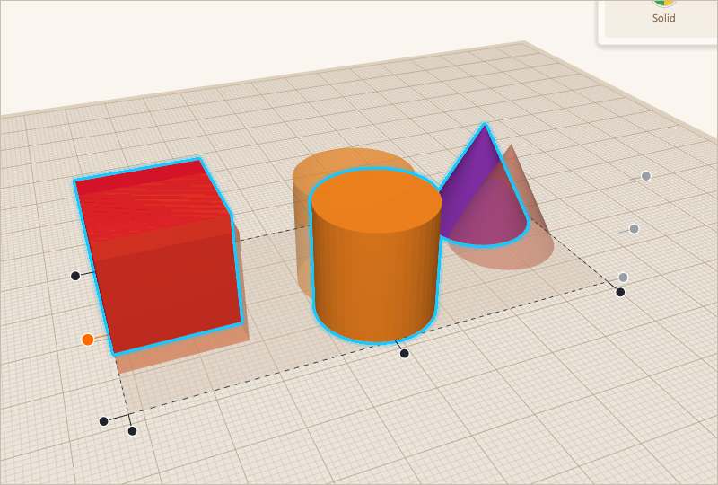
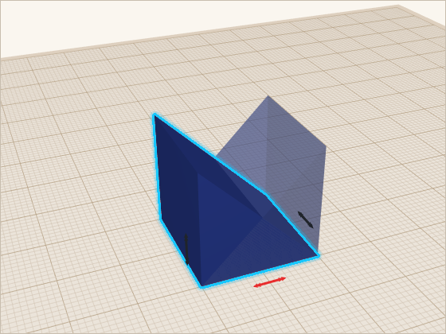
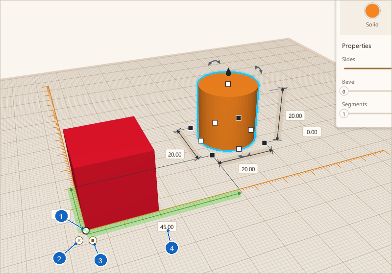
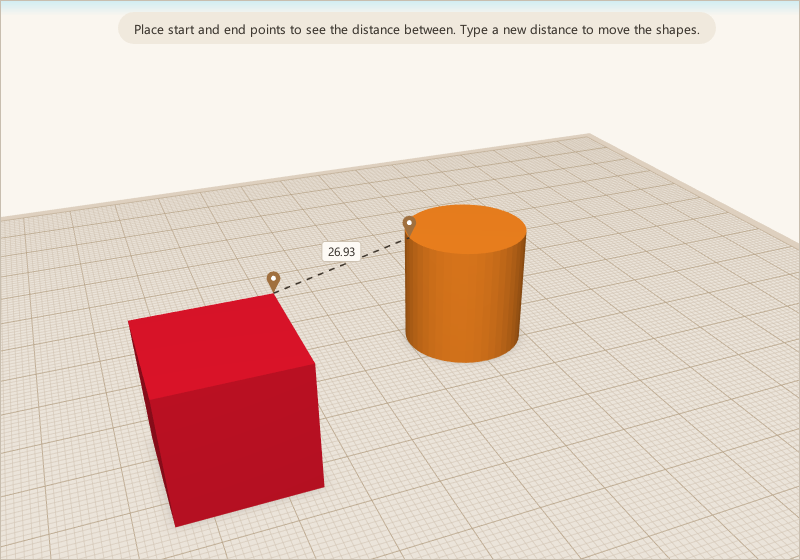
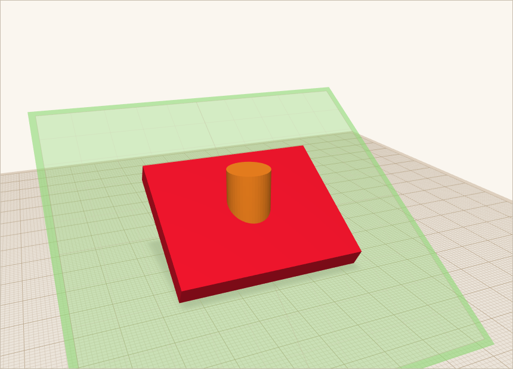
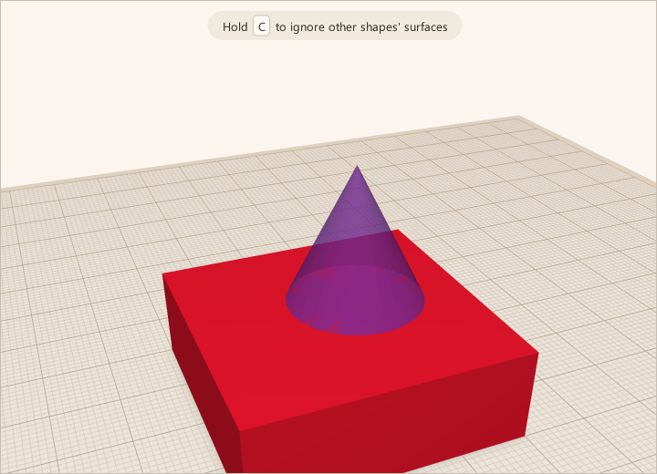
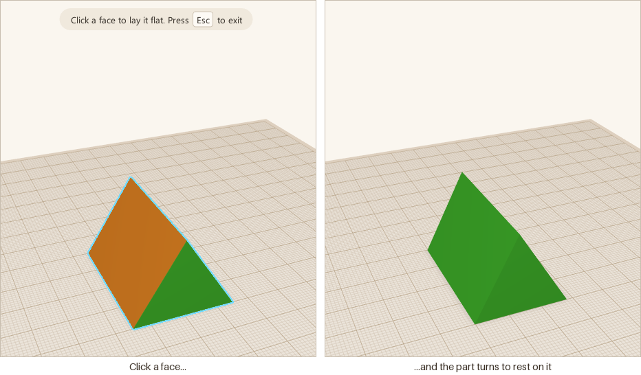
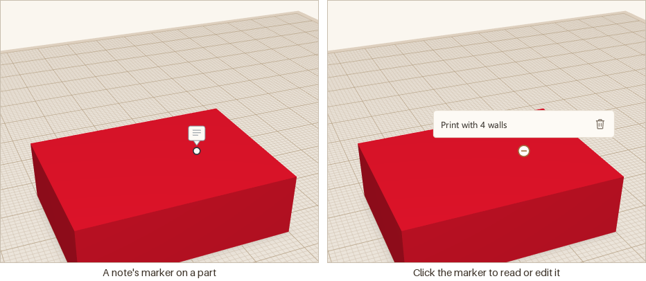

# 6. Lining up and measuring

[Contents](README.md) · Previous: [Holes and groups](05-holes-and-groups.md) · Next: [Split and section view](07-split-and-section.md)

Dragging gets shapes roughly into place. The tools in this chapter put
them exactly where they belong: lined up with each other, a set distance
apart, or sitting on a surface.

| Tool | Key | What it is for |
|---|---|---|
| [Align](#align) | **L** | Lining shapes up by their edges or middles |
| [Mirror](#mirror) | **M** | Flipping a shape |
| [Ruler](#the-ruler) | **R** | Distances from a fixed point, which you can type |
| [Measure](#measure) | | The distance between any two points |
| [Construction plane](#the-construction-plane) | **W** | Building on a tilted part |
| [Place on surface](#place-on-surface) | **C** | Setting a shape on another shape's face |
| [Drop](#drop) | **D** | Bringing a shape down onto the plate |
| [Lay flat](#lay-flat) | **Shift+D** | Putting a chosen face down on the plate |
| [Notes](#notes) | **N** | Leaving yourself a reminder on a part |

## Align

Select two or more shapes and press **L**, or click the **Align** button.
Dots appear round the selection: three along each direction, for the two
ends and the middle, and three up the side for bottom, middle and top.

- **Move the pointer over a dot** to preview where the shapes would go.
- **Click the dot** to line them up. The dots stay, so you can align in
  another direction straight away.
- **Click a shape** to make it the anchor. It stays where it is and the
  others line up to it. Click it again to go back to lining up to the
  whole selection.
- Press **Esc**, or click an empty part of the view, when you are done.

To center one shape on another in every direction, click the middle dot
in each of the three sets.

## Mirror

Select a shape and press **M**. Three double-ended arrows appear, one for
each direction. Move the pointer over one to preview the flip, and click
to flip the shape.

The shape flips about its own middle, so it stays where it is. To make a
mirrored pair, duplicate the shape first (**Ctrl+D**) and mirror the
copy.

## The ruler

The ruler measures from a point you choose, and lets you type the
distances.

1. Press **R**, or click the ruler button above the shape panel.
2. Click where you want the ruler's origin: usually a corner of a part.
3. Select a shape.

1. **The origin.** Drag it to move the ruler. Click it to turn the ruler
   a quarter turn.
2. **Remove the ruler.**
3. **Measure to midpoints** instead of to the nearest edges.
4. **Distances from the origin** to the selected shape, along each
   direction (the green bars). The shape's own sizes and its height
   above the plate are shown too.

Every number is editable. Click a distance, type a new one and press
**Enter**, and the shape moves to exactly that distance from the origin.
This is the most direct way to put a hole 12.5 mm from an edge.

The ruler stays while you work, until you remove it. It is saved with the
design, so it is still in place when you open the design again. Moving it
doesn't count as a change to the design, so you aren't asked to save
just because the ruler moved.

## Measure

The measure tool gives the distance between any two points.

1. Click the **Measure** button in the toolbar.
2. Click the first point, then the second. The points snap to the shapes
   under the pointer.

To set the distance instead of only reading it, click the number and type
a new one. The shape at the second point moves to make it so.

Press **Esc** to leave the tool.

## The construction plane

Shapes normally sit on the build plate and stand straight up. A
**construction plane** is a temporary plate that you put on a part, lined
up with that part. While it is there, new shapes land on it, shapes move
along it, and heights are measured from it. It is how you add features
square to a part that has been tilted.

There are two ways to make one:

- Select a shape and click the **Construction plane on shape** button in
  the toolbar.
- Press **W** (or click the grid button above the shape panel), then
  click the shape.

The plane goes on the underside of the shape, in line with the shape's
own length and width, however the shape has been turned.

To go back to the build plate, click the toolbar button again, or press
**W** and click the build plate.

The construction plane is saved with the design, like the ruler, so a
design reopens on the plane you were working on.

## Place on surface

**Place on surface** sets a shape down on another shape's face rather
than on the plate.

New shapes do this already: drag one from the panel over a part and it
sits on the face under the pointer.

To do the same with a shape that is already in the design, press **C**
(or click the **Place on surface** button) to turn the tool on, then
drag the shape onto the other shape's face. Press **C** again to turn it
off.

While dragging a new shape from the panel, holding **C** does the
opposite: it ignores the other shapes and puts the new one on the plate.

## Drop

**D** drops the selected shapes straight down until they rest on the
plate. Use it after turning a shape, or after lifting one by mistake. A
part that floats above the plate or sinks below it won't print as you
see it, and the [print check](09-printing.md) will say so.

## Lay flat

**Lay flat** turns a part so that the face you choose rests on the
plate. Use it to pick the side a part prints on.

1. Press **Shift+D**, or click the **Lay flat** button.
2. Move the pointer over the part. The face under it is highlighted.
3. Click the face.

Press **Esc** to leave the tool without changing anything.

## Notes

A note is a short text pinned to a point on a part: a reminder of a
screw size, a print setting, or what is left to do.

1. Press **N**, or click the speech-bubble button above the shape panel.
2. Click the spot on a shape where the note belongs.
3. Type the note. Click elsewhere when you are done.

- Click a note's marker to open it and read or change it. The bin button
  beside an open note deletes it.
- A note moves with the shape it is pinned to.
- **Shift+N** hides all the notes, and shows them again.

Notes are saved with the design. They aren't part of anything you
export.

---

[Contents](README.md) · Previous: [Holes and groups](05-holes-and-groups.md) · Next: [Split and section view](07-split-and-section.md)
