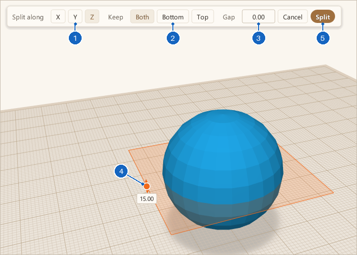
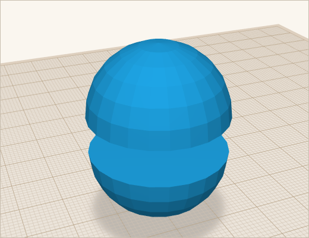
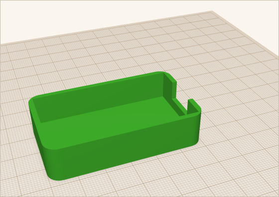
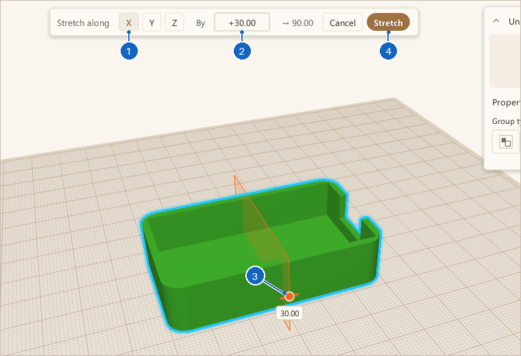
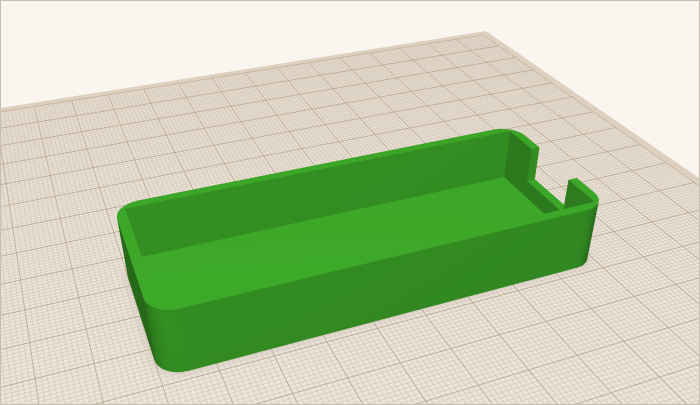
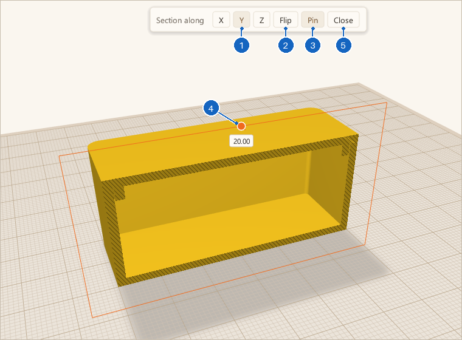

# 7. Split, stretch and section view

[Contents](README.md) · Previous: [Lining up and measuring](06-aligning-and-measuring.md) · Next: [Opening, saving, importing and exporting](08-files.md)

All three tools use a flat plane through a part. **Split** cuts the
part in two along it. **Stretch** makes the part longer or shorter
there. **Section view** only hides one side, so you can look inside;
the part itself is untouched.

## Split

Split a part to print it in pieces: a tall part in two halves that each
fit the printer, or a ball as two domes that need no support.

1. Select the part and press **K**, or click the **Split** button.
2. Set up the cut with the bar at the top of the view.
3. Click **Split**, or press **Enter**.

1. **Split along.** The direction the cut is made across: **X** and
   **Y** cut the part into left and right or front and back, **Z** into
   bottom and top. Keys: **X**, **Y**, **Z**.
2. **Keep.** Both halves, or only one of them.
3. **Gap.** Moves one half away from the other by this much after the
   cut, so the two pieces don't sit touching.
4. **The cut's position.** Drag the orange handle to move the cut, or
   click the number beside it and type. The view shows the two halves as
   they will be.
5. **Split** makes the cut. **Cancel**, or **Esc**, leaves the part
   whole.

The two halves are new shapes. To print a ball as two domes, split it,
then use [Lay flat](06-aligning-and-measuring.md#lay-flat) on the cut
face of the upper half.

Splitting is one step to undo: **Ctrl+Z** brings the whole part back.

## Stretch

Stretch makes a part longer or shorter at a plane through it, without
cutting it up: a cartridge shell lengthened for a bigger board, a box
made deeper, a bracket's arm shortened. Whatever runs along the part
through the plane, walls, ribs and grooves, just gets longer; the ends
and everything on them keep their shape.

1. Select the part and press **T**, or click the **Stretch** button.
2. Set up the stretch with the bar at the top of the view.
3. Click **Stretch**, or press **Enter**.

1. **Stretch along.** The direction the part is lengthened in. It starts
   along the part's longest side. Keys: **X**, **Y**, **Z**.
2. **By.** How much, typed one of three ways:
   - **+30** adds 30 mm at the plane.
   - **-30** takes out a 30 mm slice centred on the plane and closes the
     gap. The view shows the slice's two faces.
   - **90**, with no sign, makes the part 90 mm long; ScottiCAD works out
     how much to add or take out.

   The length the part will have is shown beside the box. In a design
   in inches, type inches.
3. **The plane's position.** Drag the orange handle, or click the number
   beside it and type. Put it where the part is the same all the way
   along, away from the ends: what the plane cuts through is what is
   carried across the gap.
4. **Stretch** makes the change. **Cancel**, or **Esc**, leaves the part
   as it was.

The low end of the part, the left, front or bottom, stays where it is,
and the other end moves.

### Changing it later

A stretch is a kind of group. The shapes inside it are kept as they were,
so you can change it at any time: select it, and Properties has its
**Axis**, **Plane Position**, **Amount** and **Length**. You can also
still change the shapes inside it, a hole's size, say, and the stretch
is made again with the change. It is saved with the design, so you can
come back to it another day.

To take a stretch off, set **Amount** to 0 and ungroup it: you get your
shapes back exactly as they were. Ungrouping a stretch that isn't 0 makes
it permanent. Shapes the plane went through become plain meshes of their
new length, like an imported file, and lose their settings; shapes
beyond the plane are moved and stay as they were. **Ctrl+Z** undoes
that, like any other step.

### Things to know

- A shape that only touches the plane is stretched across it too, so two
  boxes that meet there stay joined.
- Holes are stretched along with the rest, so a slot through the plane
  gets longer.
- When shortening, the slice's two faces should cut the part the same
  way. If they don't, for example on a tapered part, the two sides are
  joined where they meet and a step is left there.
- Shapes that weren't selected are left alone, even if the plane passes
  through them.
- An earlier ScottiCAD opens a design with a stretch in it, but shows the
  shapes unstretched.

## Section view

Section view cuts the picture, not the part. Everything on one side of a
plane is hidden, and the cut faces are drawn hatched, so you can check a
wall thickness, a hidden pocket or how two parts fit together.

Press **Shift+K**, or click the **Section view** button.

1. **Section along.** The direction the plane faces: **X**, **Y** or
   **Z**.
2. **Flip** shows the other side of the plane.
3. **Pin** keeps the section open while you select and move shapes, so
   you can work on the inside of a part. With it off, the section closes
   when you select something else.
4. **The plane's position.** Drag the orange handle, or click the number
   and type.
5. **Close**, or **Esc**, ends the section view.

With shapes selected when you start, the section cuts only those shapes
and leaves the rest whole. With nothing selected it cuts everything.

The design is never changed by a section view. Exports, the filament
estimate and the print check all use the whole parts.

---

[Contents](README.md) · Previous: [Lining up and measuring](06-aligning-and-measuring.md) · Next: [Opening, saving, importing and exporting](08-files.md)
