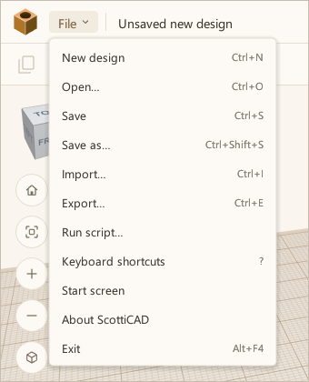
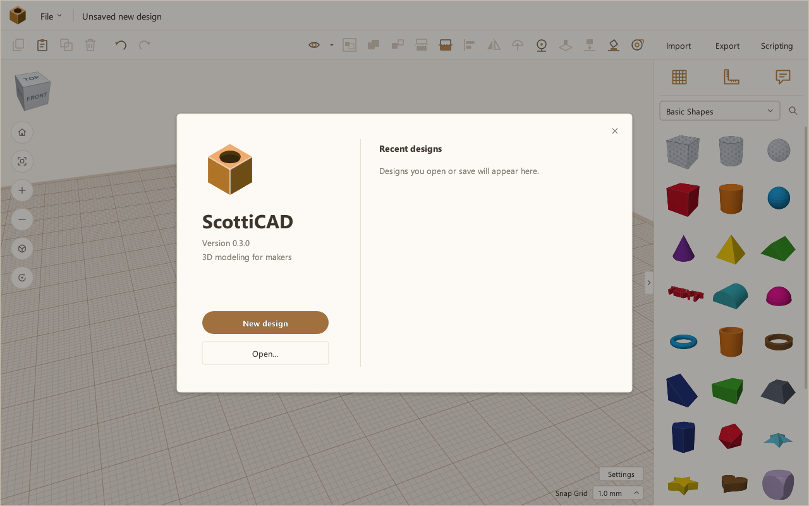
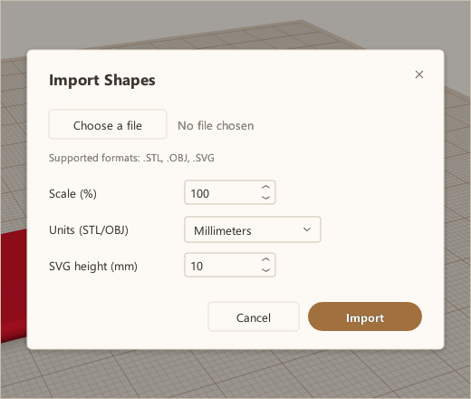
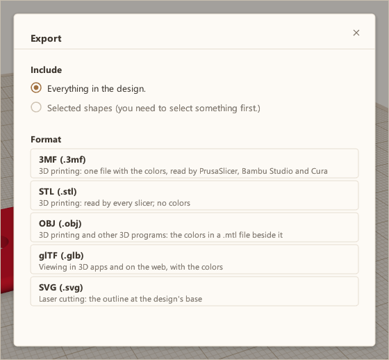

# 8. Opening, saving, importing and exporting

[Contents](README.md) · Previous: [Split and section view](07-split-and-section.md) · Next: [Getting ready to print](09-printing.md)

ScottiCAD works with three kinds of file:

- **Designs** (`.scotticad`) are what you save and open. A design keeps
  every shape, group and setting, so you can go on changing it.
- **Imports** bring other people's 3D models and drawings into a design.
- **Exports** are what you give to a slicer or another program. An
  export holds only the finished geometry.

Keep the design. An exported STL can't be turned back into shapes and
groups.

## The File menu



| Command | Keys | What it does |
|---|---|---|
| **New design** | Ctrl+N | Starts an empty design |
| **Open…** | Ctrl+O | Opens a `.scotticad` design |
| **Save** | Ctrl+S | Saves the design. The first time, it asks for a name and a folder |
| **Save as…** | Ctrl+Shift+S | Saves a copy under another name and carries on in the copy |
| **Import…** | Ctrl+I | Brings a model or drawing into this design |
| **Export…** | Ctrl+E | Writes a file for a slicer or another program |
| **Run script…** | | Opens a script and runs it ([Scripting](11-scripting.md)) |
| **Keyboard shortcuts** | ? | Shows the list of keys |
| **Start screen** | | Shows the start screen again |
| **About ScottiCAD** | | The version you are running |
| **Exit** | Alt+F4 | Closes ScottiCAD |

The design's name is shown beside the File menu. If you close a design
with changes you haven't saved, ScottiCAD asks whether to save them
first.

## The start screen

ScottiCAD opens on its start screen. **New design** starts with an empty
build plate, **Open…** opens a design, and the **Recent designs** list
has the last eight you opened or saved: click one to open it.



You can also open a design by double-clicking its file, if ScottiCAD is
set up to open `.scotticad` files (on Linux, `install.sh` does this), or
by naming it when you start ScottiCAD from a command line:

```
scotticad my-part.scotticad
```

## Importing

**Import** adds a file's contents to the design as a new shape, in the
middle of the view. Click **Import** at the top right, or press
**Ctrl+I**.



| File | What you get |
|---|---|
| **STL**, **OBJ** | The 3D model as one shape. You can move, resize and turn it, make it a hole, and group it with other shapes |
| **SVG** | The drawing's outlines, raised into a solid of the height you give |

The options:

- **Scale** makes the import bigger or smaller. 100% leaves it as it
  is.
- **Units (STL/OBJ).** These files hold numbers without units. Most are
  in millimetres. If a model comes in 25 times too small, it was made in
  inches: import it again with **Inches** chosen.
- **SVG height** is how thick the solid made from a drawing is, in
  millimetres.

On Windows you can also drag files from a folder onto the ScottiCAD
window to import them.

Models with small flaws, such as gaps in their surface, are repaired as
they are read, so that they can be grouped and cut like any other shape.

### Things to do with an import

- **Cut it.** Add holes and group them with the model, to drill a
  mounting hole in a downloaded part.
- **Add to it.** Group it with new solids: a base, a label, a hook.
- **Use it as a hole.** Make the model a hole and group it with a block
  to get a cavity in its shape.
- **Engrave a logo.** Import an SVG, make it a hole, sink it slightly
  into a surface and group.

## Exporting

Click **Export** at the top right, or press **Ctrl+E**.



First choose what to **include**: everything in the design, or only the
selected shapes. Hidden shapes are left out of "everything", and holes
that aren't in a group are never exported.

Then click a format. ScottiCAD asks where to save the file.

| Format | Use it for | Colours |
|---|---|---|
| **3MF** | 3D printing. Read by PrusaSlicer, Bambu Studio and Cura | Yes: one part per colour |
| **STL** | 3D printing. Read by every slicer | No |
| **OBJ** | 3D printing and other 3D programs | Yes, in a `.mtl` file saved beside it |
| **glTF** (`.glb`) | Viewing in 3D apps and on the web | Yes |
| **SVG** | Laser cutting: the outline of the design where it meets the plate | No |

Exported parts are closed solids, with every group joined and every hole
cut.

In a 3MF file, pieces laid out apart are separate objects, so a slicer
can move and arrange them one by one. Each object's colours are its
parts, locked together: a two-colour lid stays one object. Pieces that
touch or overlap stay together as one object.

A big design can take a few seconds to export. ScottiCAD does it in the
background and shows the file's name at the top of the view while it
works; you can carry on editing.

If the [print check](09-printing.md) has warnings for what you are about
to export, the dialog says so at the bottom. Click **Show** to see them.
The warning never stops you exporting.

## If something goes wrong

If ScottiCAD ever has to close because of an internal error, it first
saves your design to a recovery file and tells you where: in the
design's own folder, or in your Documents folder for a design you
hadn't saved yet. The file is named after the design, with "(recovered)"
and the time. Open it like any other design.

---

[Contents](README.md) · Previous: [Split and section view](07-split-and-section.md) · Next: [Getting ready to print](09-printing.md)
