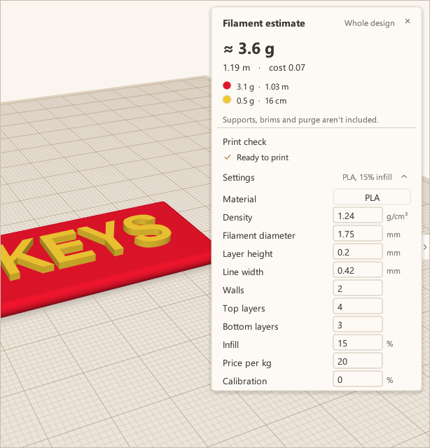
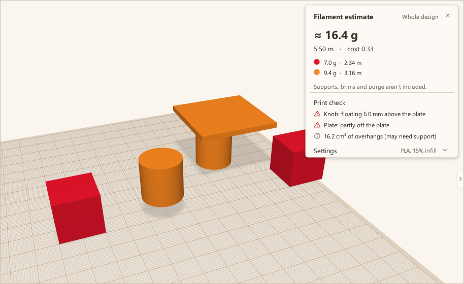
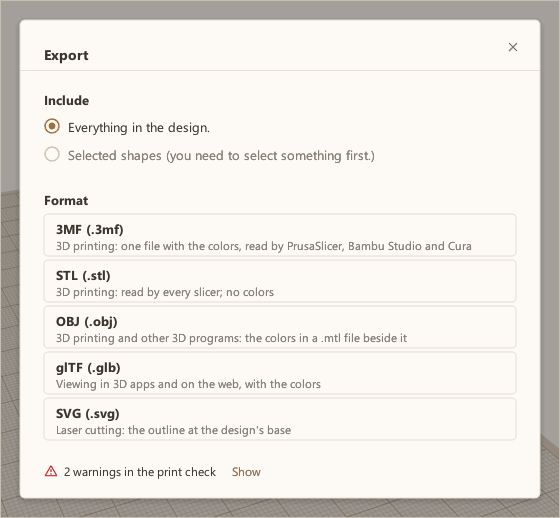

# 9. Getting ready to print

[Contents](README.md) · Previous: [Opening, saving, importing and exporting](08-files.md) · Next: [Settings](10-settings.md)

Before you export, ScottiCAD can tell you two things: roughly how much
filament the part will use, and whether anything about it will go wrong
in the slicer. Both are in one panel. Click the **spool** button at the
right end of the toolbar to open it.

The panel covers the **selection**, or the **whole design** when nothing
is selected. It says which at the top.

## The filament estimate

The estimate gives the weight of filament, its length and its cost. For
a design in several colours it lists each colour.

It is an estimate. It works from each part's volume and surface and the
print settings below, without slicing the part, so it won't match your
slicer's figure exactly. Supports, brims and purge towers aren't
included.

Click **Settings** in the panel to enter your own print settings. They
should match what you use in your slicer.

| Setting | Meaning |
|---|---|
| **Material** | PLA, PETG, ABS, ASA, TPU, PC or Nylon. Choosing one sets the density |
| **Density** | In g/cm³, if your filament differs from the usual figure |
| **Filament diameter** | In mm: 1.75 for most printers |
| **Layer height**, **Line width** | As in your slicer |
| **Walls**, **Top layers**, **Bottom layers** | The number of each |
| **Infill** | In percent |
| **Price per kg** | What a kilogram of your filament costs, in your own currency. Leave it at 0 to hide the cost |
| **Calibration** | A percentage added to every estimate. If your prints always weigh 5% more than estimated, enter 5 |

ScottiCAD remembers these settings between sessions.

## The print check

The print check looks at each part the way a slicer will receive it and
reports anything that needs attention.

- A **tick** means the parts are ready to print.
- A **warning triangle** marks something that will probably spoil the
  print. Fix it before exporting.
- An **ⓘ** marks something worth knowing that needs nothing done.

Click a line to select the part it is about. Hold the pointer over a
line to see what to do.

### What it checks

| Message | What it means | What to do |
|---|---|---|
| **floating … above the plate** | The part's lowest point is above the build plate | Press **D** to drop it onto the plate |
| **… below the plate** | Part of it is under the plate. The slicer will cut that off, or lift the part | Press **D** |
| **partly off the plate** | It hangs over the edge of the build plate | Move it back on. If you mean to print parts one at a time, this is harmless |
| **bigger than the … plate** | It won't fit your printer as it stands | Scale it down or [split](07-split-and-section.md) it. If your printer is bigger, set its size in [Settings](10-settings.md) |
| **a hole in the surface** | The part isn't a closed solid. Slicers may not warn about this, and it can print with a flaw | Usually an imported model: try importing it again, or repair it in your slicer |
| **faces that don't join up** | Faces are doubled, or a stray face hangs off an edge | As above |
| **inside out** | An imported model whose surface faces inward | Fix it in the program that made it, or in your slicer |
| **a piece in mid-air** ⓘ | Part of a group rests on nothing | It will print on supports, or not at all. Lower it, or join it to the rest |
| **hairline cracks** ⓘ | Gaps in the surface too narrow to show in a print | Nothing |

When you click a warning about a hole in the surface or faces that don't
join up, the edges at fault are marked in red on the part, so you can
see where the trouble is.

### Overhangs

The last line of the check gives the area of **overhangs**: faces that
lean out more than 45° and face downward with nothing under them. These
are the surfaces a slicer may put supports under.

The figure is information, not a warning. Short bridges and gentle
curves often print well without support, and your slicer's preview shows
where it would add any. A large figure is a prompt to ask whether the
part would print better another way up: try
[Lay flat](06-aligning-and-measuring.md#lay-flat) on a different face
and see how the figure changes.

Faces resting on the plate or on the part below don't count, and nor
does a rounded bottom edge.

### The same warning when you export

If there are warnings for what you are about to export, the Export
dialog says so. Click **Show** to open the print check.

## A checklist before printing

1. Group everything that should be one part.
2. Press **D** with the part selected, so it sits on the plate.
3. Open the filament panel and read the print check.
4. Look inside with [section view](07-split-and-section.md#section-view)
   if the part has hidden pockets or thin walls.
5. Export as STL, or as 3MF for colours.

---

[Contents](README.md) · Previous: [Opening, saving, importing and exporting](08-files.md) · Next: [Settings](10-settings.md)
