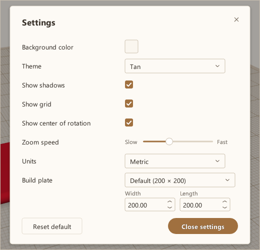
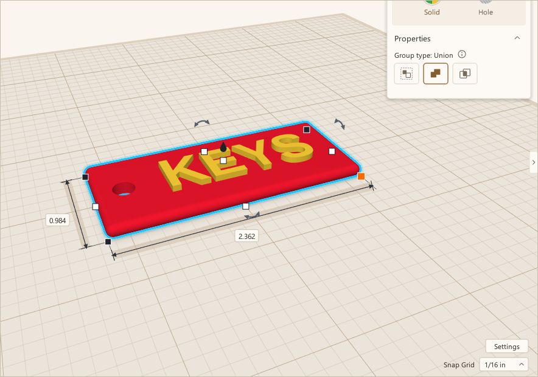
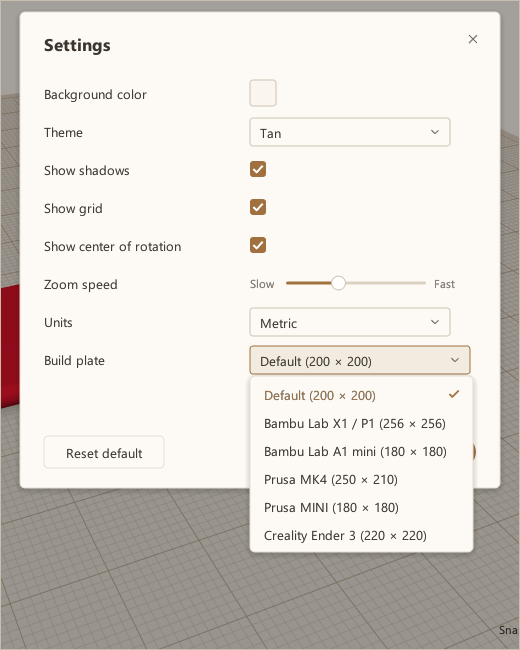
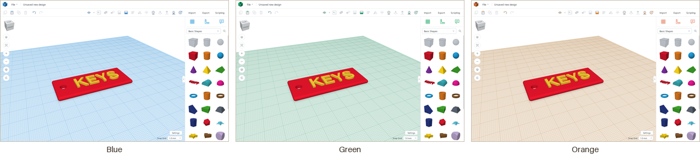
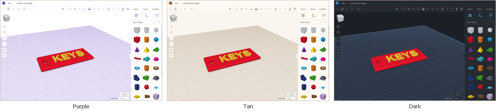

# 10. Settings

[Contents](README.md) · Previous: [Getting ready to print](09-printing.md) · Next: [Scripting](11-scripting.md)

Click **Settings**, at the bottom right of the view, to open the
settings.

**Background color**, **Theme**, **Zoom speed** and **Show center of
rotation** change at once. The other settings take effect when you click **Close
settings**; press **Esc** to close the dialog without keeping them.
**Reset default** puts every setting back as it was when ScottiCAD was
new.

| Setting | What it does |
|---|---|
| **Background color** | The colour behind the build plate. Click the swatch to choose |
| **Theme** | The colours of the whole window. See below |
| **Show shadows** | The soft shadow each shape casts on the plate |
| **Show grid** | The grid lines on the build plate |
| **Show center of rotation** | The marker that shows the point the view turns round while you orbit ([Looking around](02-looking-around.md#the-center-of-rotation)) |
| **Zoom speed** | How far one click of the mouse wheel zooms |
| **Units** | Metric (millimetres) or Imperial (inches) |
| **Build plate** | The size of the plate: a printer from the list, or your own width and length |

## Units

Choose **Imperial** to work in inches. Every number in the program
changes: sizes, distances, the ruler, the snap grid (which becomes
fractions of an inch) and the grid on the plate.

Changing the units doesn't change the size of anything. A 25.4 mm cube
becomes a 1 inch cube.

Whatever the units, you can type a size in the other system by adding
the unit: `25mm` in an inch design, `1/2in` in a millimetre one. See
[Sizing with exact numbers](04-moving-and-sizing.md#sizing-with-exact-numbers).

The units are saved with each design.

## The build plate

The build plate stands for your printer's bed. Set it to your printer's
size, and the [print check](09-printing.md) can tell you when a part is
too big or hangs over the edge.

Choose a printer from the **Build plate** list, or type a **Width** and
**Length**.

| Preset | Size |
|---|---|
| Default | 200 × 200 mm |
| Bambu Lab X1 / P1 | 256 × 256 mm |
| Bambu Lab A1 mini | 180 × 180 mm |
| Prusa MK4 | 250 × 210 mm |
| Prusa MINI | 180 × 180 mm |
| Creality Ender 3 | 220 × 220 mm |

The plate's size is saved with each design.

## Themes

A theme sets the colours of the window and the build plate. There are
six.

The theme is a setting of the program, not of the design: it stays as
you set it for every design you open.

## The snap grid

The **Snap Grid**, beside the Settings button, is the step that shapes
move and resize by. It is covered in
[Moving, sizing and turning](04-moving-and-sizing.md#the-snap-grid).

## Filament settings

The print settings behind the filament estimate have their own place, in
the filament panel. See [Getting ready to print](09-printing.md).

---

[Contents](README.md) · Previous: [Getting ready to print](09-printing.md) · Next: [Scripting](11-scripting.md)
