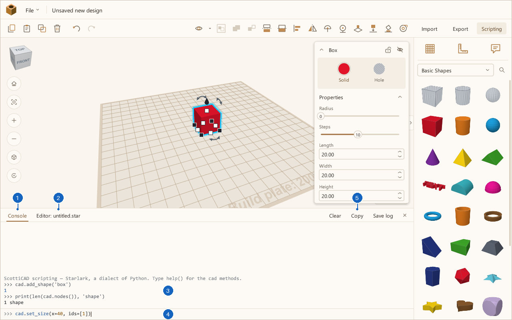
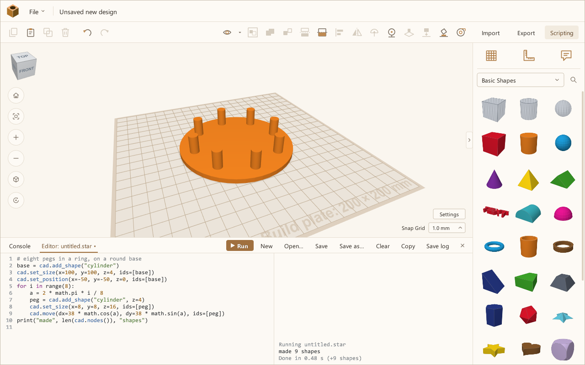

# 11. Scripting

[Contents](README.md) · Previous: [Settings](10-settings.md) · Next: [Working with an AI assistant](12-ai-assistant.md)

Anything you can do with the mouse you can also do with a few lines of
code. A script is worth writing when a part has many similar features
(forty holes in a grid), when it should come in several sizes, or when
its shape follows from a calculation.

This chapter introduces the scripting console. The full list of commands
is in the [API reference](../api.md), and the
[`examples`](../../examples) folder has over a dozen commented scripts to
learn from.

## The console

Click **Scripting**, at the top right, to open the console under the
view.



1. **Console** tab: type one command at a time.
2. **Editor** tab: write and run whole scripts.
3. **The transcript**: what you typed, what it printed, and any errors.
4. **The prompt.** Type a command after `>>>` and press **Enter**.
5. **Clear**, **Copy** and **Save log** act on the transcript.

Try it. Type each line and press **Enter**:

```python
box = cad.add_shape("box")
cad.set_size(x=40, y=30, z=10, ids=[box])
```

A box appears, then changes size. Type `help()` for the list of
commands.

## The language

Scripts are written in Starlark, a small dialect of Python. If you know
some Python, you know it: variables, `if`, `for`, functions, lists and
dictionaries all work the same way. There are no classes, no
`try`/`except` and no `import`. The `math` functions are built in.

Everything goes through one object, `cad`. A few of its commands:

| Command | What it does |
|---|---|
| `cad.add_shape("box", x=0, y=0)` | Adds a shape, centered on that point of the plate, and returns its id |
| `cad.set_size(x=40, ids=[a])` | Sets a shape's size |
| `cad.set_position(x=0, y=0, z=0, ids=[a])` | Puts a shape's corner at a point |
| `cad.move(dx=10, ids=[a])` | Moves a shape |
| `cad.rotate("z", 45, ids=[a])` | Turns a shape |
| `cad.set_param(a, "radius", 2)` | Changes one of a shape's own settings |
| `cad.set_hole(True, ids=[a])` | Makes a shape a hole |
| `cad.group("union", ids=[a, b])` | Groups shapes and returns the group's id |
| `cad.set_color("#2a7fd4", ids=[a])` | Sets a colour |
| `cad.export("part.stl")` | Exports the design |

Sizes and positions are in millimetres. Each shape has a short name for
scripts, usually its name in [the shape library](13-shape-library.md) in
lower case without spaces: `"cylinder"`, `"roundroof"`, `"spurgear"`.
`cad.shape_kinds()` lists them all, with their settings.

## Writing a script

Click the **Editor** tab. The editor is on the left and the transcript
on the right.



```python
# eight pegs in a ring, on a round base
base = cad.add_shape("cylinder")
cad.set_size(x=100, y=100, z=4, ids=[base])
cad.set_position(x=-50, y=-50, z=0, ids=[base])
for i in range(8):
    a = 2 * math.pi * i / 8
    peg = cad.add_shape("cylinder", z=4)
    cad.set_size(x=8, y=8, z=16, ids=[peg])
    cad.move(dx=38 * math.cos(a), dy=38 * math.sin(a), ids=[peg])
print("made", len(cad.nodes()), "shapes")
```

| To | Do this |
|---|---|
| Run the script | Click **Run**, or press **F5** or **Ctrl+Enter** |
| Stop a script that is taking too long | Click **Stop**, or press **Ctrl+C** |
| Save the script | **Save**, or **Ctrl+S**. Scripts are `.star` files |
| Open a script | **Open…**, or **Ctrl+O** |
| Start a new one | **New** |

Useful to know:

- **A whole run is one step to undo.** Press **Ctrl+Z** and everything
  the script made is gone, so you can change a number and run it again.
- **Errors are links.** When a script fails, the transcript shows the
  error and its line. Click it to jump to that line in the editor.
- **Put the sizes at the top.** Give the numbers that matter names
  (`HOLES = 8`, `RADIUS = 38`) at the top of the script. Changing the
  part is then a matter of changing one line and pressing **F5**.
- **File → Run script…** opens a script and runs it in one go.

## What scripts can and can't reach

A script works on the design, and on nothing else. It can't read or
write your files, use the network or start other programs. The only
files it touches are the ones it names in `cad` commands that are for
files: `cad.open`, `cad.save`, `cad.export`, `cad.import_file` and
`cad.screenshot`.

## Shapes that only scripts can make

Two shapes are made from lists of points, so they come from scripts
rather than from the shape panel:

- **An outline** is a flat shape, drawn as a list of corner points, and
  raised to a height. Outlines drawn inside another are holes in it.
- **A loft** joins a stack of outlines at different heights into one
  solid: a vase, a funnel, a boat's hull.

```python
# a plate with a rectangular window in it, 3 mm thick
plate = cad.add_outline([[(0, 0), (40, 0), (40, 25), (0, 25)],
                         [(15, 8), (25, 8), (25, 17), (15, 17)]], z0=0, z1=3)

# a vase: a hexagon at the base turning into circles higher up
def ring(r, n):
    return [(r * math.cos(2 * math.pi * i / n), r * math.sin(2 * math.pi * i / n)) for i in range(n)]

vase = cad.add_loft([(0, ring(20, 6)), (40, ring(28, 48)), (80, ring(12, 48)), (95, ring(16, 48))])
```

Once made, they behave like any other shape: you can move, resize, group
and cut them with the mouse.

## Driving ScottiCAD from Python

The same commands are available to ordinary Python programs running
outside ScottiCAD, through the automation API. That suits batch jobs:
making fifty name tags from a list, or exporting a part in every size.

```python
from scotticad import launch

with launch(headless=True) as cad:
    box = cad.add_shape("box")
    cad.set_size(x=40, y=30, z=10, ids=[box])
    cad.export("part.stl")
```

The [API reference](../api.md) describes how to set it up, and every
command.

---

[Contents](README.md) · Previous: [Settings](10-settings.md) · Next: [Working with an AI assistant](12-ai-assistant.md)
