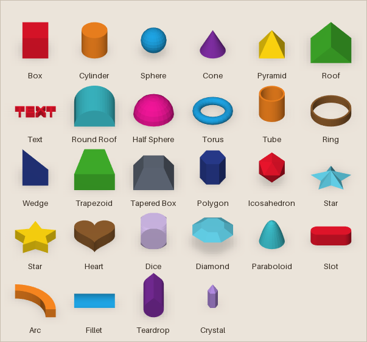
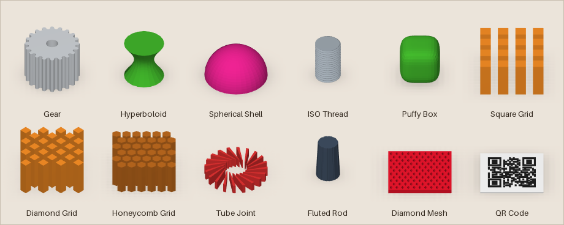
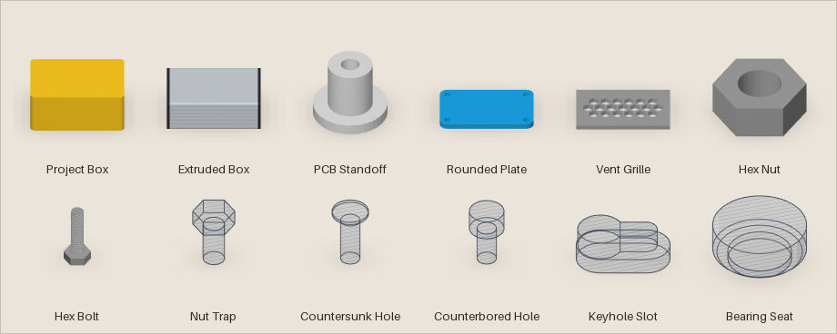
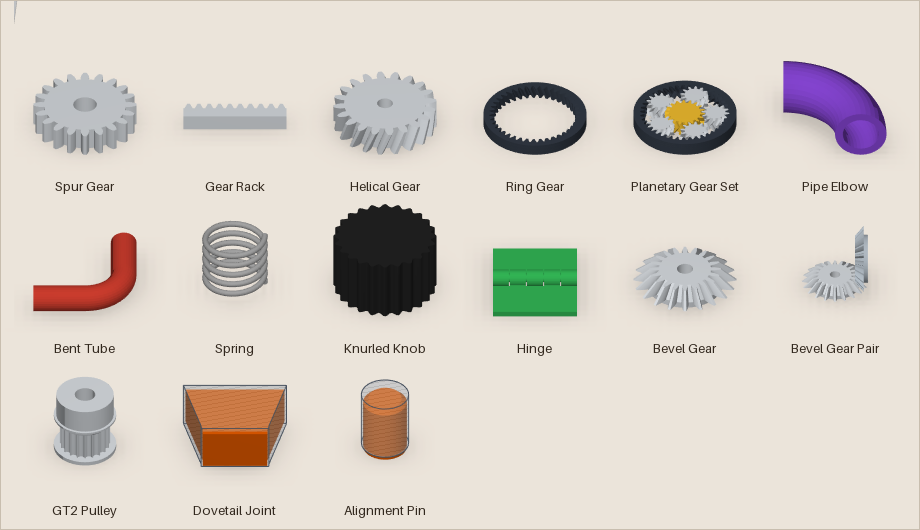
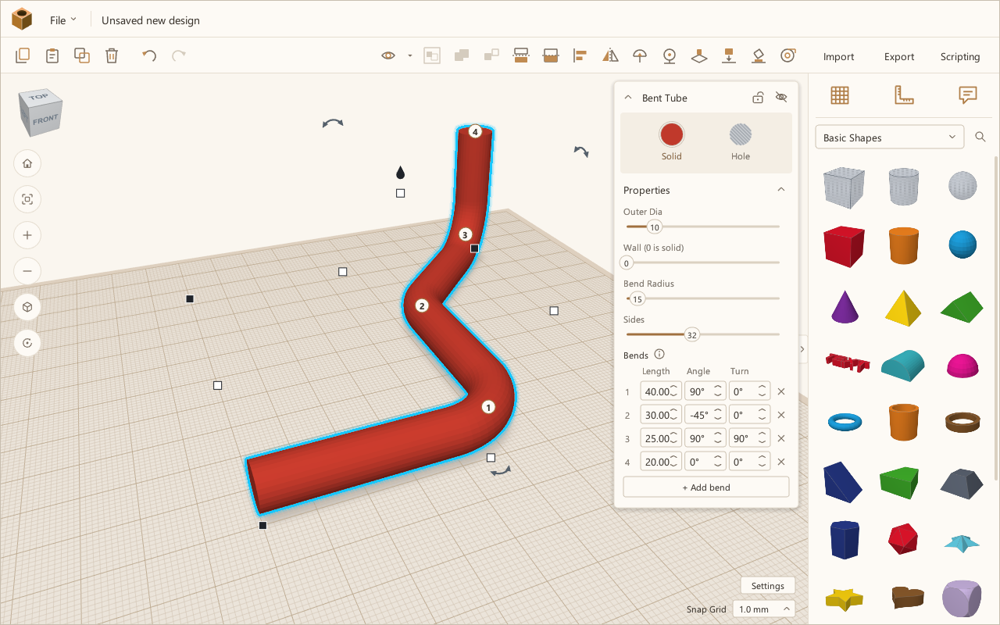
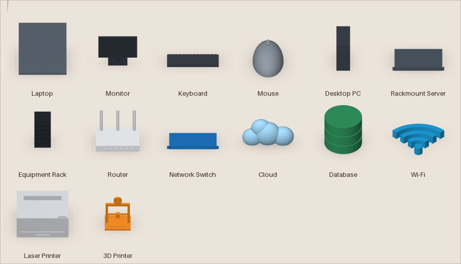

# 13. The shape library

[Contents](README.md) · Previous: [Working with an AI assistant](12-ai-assistant.md) · Next: [Keyboard and mouse](14-keyboard-and-mouse.md)

Every shape in the shape panel, library by library. Choose a library
from the list at the top of the panel, or use the search
([Shapes](03-shapes.md#the-shape-panel)).

The pictures show the shapes at about the same size so they fit the
page. In ScottiCAD each comes in at a sensible real size: a hex nut is a
few millimetres across and an equipment rack is not.

## Basic Shapes

The building blocks. The panel also has the box, the cylinder and the
sphere ready-made as holes, at the top. Any other shape becomes a hole
with the **Hole** button in Properties.

Most have a few settings in Properties. Some worth knowing:

| Shape | Settings |
|---|---|
| **Box** | **Radius** rounds the edges; **Steps** sets how smooth the rounding is |
| **Cylinder** | **Sides**: 48 looks round, 6 makes a hexagon. **Bevel** rounds the top and bottom edges |
| **Sphere** | **Steps**: more is smoother |
| **Cone** | **Top Radius**: above zero, the cone has its tip cut off. **Sides** |
| **Pyramid** | **Sides**: the number of sides of its base |
| **Tube**, **Ring** | The wall thickness, and the number of sides |
| **Torus** | The size of the ring and of the tube that forms it |
| **Polygon** | The number of sides |
| **Star** (the pointed one) | The number of points and how deep they are |
| **Tapered Box**, **Trapezoid** | The sizes of the base and of the top |
| **Text** | The words, the font and how far the letters stand up ([Text](03-shapes.md#text)) |
| **Slot** | A box with fully round ends. Its ends stay round whatever size you make it. Made a hole, it is a slot a screw can slide along |
| **Arc** | Part of a ring: **Radius**, **Wall Thickness** (0 makes a pie slice) and **Angle**, from 1° to a full circle. Changing a setting keeps the arc's center where it is, so the arc grows or shrinks round it |
| **Fillet** | A bar whose curved face fills an inside corner. See below |
| **Teardrop** | A round bar lying on its side with a 45° point on top. See below |
| **Crystal** | A quartz crystal: **Sides**, **Point Height**, **Taper**, **Double Pointed**, and **Irregularity** with **Seed**. See below |

Fewer sides or steps make a shape faceted, which can be a style in its
own right. More make it smoother, and slower to combine in big groups.

### The fillet

Place a **Fillet** as a solid along the line where a wall meets a floor:
its curved face rounds the inside corner and makes the joint stronger.
It arrives the right way round for a wall at its back and a floor under
it; turn it for other corners.

Made a hole and laid along an outside edge with its curved face toward
the part, it cuts that one edge round, where the box's **Radius** rounds
every edge.

### The teardrop

A round hole running sideways through a part sags at the top when it is
printed, because its roof has nothing under it. A **Teardrop** made a
hole fixes that: its top rises to a point at 45°, which prints without
support. It arrives lying down, ready to use. **Flat Top** cuts the
point off level with the top of the circle, which keeps the hole closer
to round; the short flat roof bridges.

### The crystal

**Irregularity** makes the faces unequal, as on real quartz, and
**Seed** picks which crystal you get: each seed is a different crystal,
and the same seed always gives the same one. Give each crystal in a
cluster its own seed so they don't look stamped out. A crystal with one
point prints standing on its foot; a double-pointed one needs to lie on
a face or be sunk into something.

## Parametric

Shapes built from their settings. Change the numbers in Properties and
the shape is made again.

| Shape | What it is |
|---|---|
| **Gear** | A simple gear with rounded teeth, for decoration and light duty. For gears that mesh properly, use the Mechanical library |
| **Hyperboloid** | A waisted tower, like a cooling tower |
| **Spherical Shell** | A hollow dome with a wall thickness |
| **ISO Thread** | A metric screw thread. Set its **Pitch**, and size it with the handles to the diameter and length you need. As a solid it is a threaded rod; as a hole it cuts a threaded hole |
| **Puffy Box** | A box with bulging faces |
| **Square Grid**, **Diamond Grid**, **Honeycomb Grid** | Open grids, for vents, trays and light panels |
| **Tube Joint** | A ring of angled blades between an inner and an outer radius |
| **Fluted Rod** | A rod with grooves down its length: a handle or a grip |
| **Diamond Mesh** | A flat panel of diamond openings |
| **QR Code** | A scannable code for the text you type. See below |

Printed threads need room. Make a threaded hole a little larger than its
bolt, and try a short test piece before printing the part.

### The QR code

Type a link, a message or a Wi-Fi login in the **QR Code**'s **Text**,
and it becomes a code a phone can scan. It comes in two parts, a pale
**base** with the blank margin a scanner needs and the dark **code**
standing on it, so it prints in two colours.

- **Error Correction**: how much of the code can be damaged or misprinted
  and still scan, from Low (7%) to High (30%). Higher needs more squares,
  so they are smaller at the same size.
- **Size**: the whole width, margin included.
- **Height**: how far the code stands up from the base.
- **Base**: the base's thickness. At 0 there is no base: stand the code on
  a part of your own, or make it a hole to engrave it into one.
- **Margin**: the blank border, in squares. Scanners want 4.

A longer text makes a code with more, smaller squares. Keep each square
at least about 0.8 mm (two nozzle widths): a short link fits in about
25 mm, a long one needs more. A code holds up to 271 characters at Low
error correction, 213 at Medium, 151 at Quartile and 119 at High. If
the text is too long for the level you chose, the highest level it fits
is used. These counts are for plain letters, digits and spaces; an
accented letter or a symbol takes the room of two to four.

Contrast is what makes a code scan: print the two parts in a dark and a
light colour. Scan a printed code with your phone before you rely on it.

QR Code is a registered trademark of DENSO WAVE INCORPORATED.

## Hardware & Enclosures

Cases, and the fittings that go on them.

| Shape | What it is |
|---|---|
| **Project Box** | A box with a lid: length, width, height, wall thickness and corner radius. Ungroup it to get the body and the lid as separate parts to print |
| **Extruded Box** | A case in the style of an aluminium extrusion, with grooved sides, card slots inside and two end panels |
| **PCB Standoff** | A post for mounting a circuit board, with a hole for the screw and a flange at the base |
| **Rounded Plate** | A plate with rounded corners and a mounting hole in each |
| **Vent Grille** | A panel of ventilation holes |
| **Hex Nut**, **Hex Bolt** | Metric fasteners, by M size (and length, for the bolt) |
| **Nut Trap** ◌ | A pocket that holds a nut, with the hole for its bolt |
| **Countersunk Hole** ◌ | A hole for a flat-head screw |
| **Counterbored Hole** ◌ | A hole with a recess for a cap-head screw |
| **Keyhole Slot** ◌ | For hanging a part on a screw: a round hole the screw's head goes through, and a slot it slides along, where a lip holds the head. **Recess Depth** is the room behind the lip for the head to slide in |
| **Bearing Seat** ◌ | A pocket a ball bearing presses into. See below |

The five marked ◌ come as **holes**. Each cuts down into the top of a
part: place it where the screw or bearing goes and group it with the
part.

### The bearing seat

Choose the **Bearing** from the list (the 608 is the common skateboard
bearing). Each is listed by its bore, outside diameter and width in
millimetres.

The seat is as deep as the bearing is wide, plus 0.5 mm. The floor's
edge is bevelled at 45°: the bearing's outer race stops on the bevel,
and its inner race, which turns with the shaft, stays clear of the
floor. The bearing's face ends level with the part's top, or a few
tenths of a millimetre above it, depending on how rounded the bearing's
own edge is.

- **Fit** is added to the bearing's outside diameter. 0.1 mm is a firm
  press fit on most printers; raise it if the bearing won't go in, lower
  it (even below 0) if it falls out.
- **Hole Below** carries on through the floor, narrower than the
  bearing, so a shaft can pass and a rod can push the bearing out. Set
  it to 0 for a blind pocket.

Print a seat on its own first to find the fit your printer needs.

## Mechanical

Moving parts.

| Shape | What it is |
|---|---|
| **Spur Gear** | A true involute gear: module, number of teeth, thickness and bore. Two gears with the same module mesh |
| **Gear Rack** | A straight bar of teeth, to mesh with a spur gear |
| **Helical Gear** | A gear with slanted teeth. It can be made a herringbone gear, whose V-shaped teeth keep meshing gears in line |
| **Ring Gear** | A ring with teeth on the inside |
| **Planetary Gear Set** | A sun gear, planets and a ring, already meshed. It prints in one piece, assembled |
| **Pipe Elbow** | A curved pipe, by diameter, wall, bend radius and angle |
| **Bent Tube** | A tube with any number of bends. See below |
| **Spring** | A coil spring |
| **Knurled Knob** | A knob with a gripping edge |
| **Hinge** | A hinge that prints in one piece, assembled |
| **Bevel Gear** | A gear on a cone, for turning a drive through a right angle. See below |
| **Bevel Gear Pair** | Two bevel gears already in mesh, their shafts at 90° |
| **GT2 Pulley** | A toothed pulley for the 2 mm GT2 belt most 3D printers use: **Teeth**, **Belt Width**, **Bore**, **Flanges** (none, the lower one, or both) and a **Hub**. It prints as it arrives, flange down and hub up, without support. **Groove Fit** widens the grooves for printing |
| **Dovetail Joint** | A dovetail key and its socket, for joining two parts. See below |
| **Alignment Pin** | A pin and its socket, for lining up two parts. See below |

Parts that print already assembled depend on the gap between their
pieces. If yours come out fused, your printer needs a larger gap; if
they rattle, a smaller one. Print one on its own to find out before
building it into a design.

### Bevel gears

Two bevel gears mesh when they have the same **Module** and each is set
to the other's tooth count in **Mate Teeth**: a 15-tooth gear with Mate
Teeth 30 meshes with a 30-tooth gear with Mate Teeth 15. Equal counts
give a pair of the same size (mitre gears). The **Bevel Gear Pair** places
both, in mesh: ungroup it to print them separately.

Each gear has a flat back to print on, and **Back** adds a plain disc
under it for strength. **Face Width** is the teeth's length along the
cone; it can't be more than a third of the way to the cone's point,
where the teeth get too small. **Clearance** thins each tooth face for
printing.

### Joints: the dovetail and the pin

Both come as a pair: a **key** (a solid) and its **socket** (a hole),
the socket larger than the key by **Clearance** on every side. Use them
to join two parts, for example the halves of a part [split](07-split-and-section.md)
to fit your build plate:

1. Place the joint where the two parts meet.
2. Ungroup it (**Ctrl+Shift+G**).
3. Group the key with one part and the socket with the other.

The **Dovetail Joint**'s key belongs to the part at the front (it is sunk
1 mm into it) and widens into the part behind, so the two can only slide
apart up and down. Set its **Height** to the parts' height.

The **Alignment Pin** stands on the part below (sunk 1 mm into it) and
reaches up into its socket in the part above. Its tip is chamfered so it
finds the socket. Drop it onto the top of the lower part; on the bare
build plate it sits 1 mm below the plate.

0.2 mm of clearance suits joints that should stay together; print one
joint on its own first to check it on your printer.

### The bent tube

A **Bent Tube** is made the way a tube bender makes one: from a table of
straight lengths and bends.

The sliders set the tube itself: its **outer diameter**, its **wall**
(0 makes a solid rod), the **bend radius** and the number of **sides**.

Each row of the **Bends** table is one step along the tube:

- **Length**: a straight run.
- **Angle**: then a bend through this many degrees. A negative angle
  bends the other way.
- **Turn**: before bending, turn the bend about the tube by this many
  degrees. With every Turn at 0 the tube stays flat; a Turn of 90 takes
  the next bend out of that plane.

**Add bend** adds a row and the **×** at the end of a row removes it.
The numbered markers on the tube show which row is which; click a marker
to go to its row.

The tube keeps its starting end where it is when you change the table,
so tubes joined end to end stay joined.

## Computers & Networking

Simple models of equipment: a laptop, monitor, keyboard, mouse, desktop
PC, rackmount server, equipment rack, router, network switch, cloud,
database, Wi-Fi symbol, laser printer and 3D printer.

They are for laying out a desk, a rack or a network diagram in 3D. They
have no settings of their own; resize them with the handles.

## Shapes that scripts make

Two more shapes, the **outline** and the **loft**, are made from lists
of points, so they come from scripts. See
[Scripting](11-scripting.md#shapes-that-only-scripts-can-make).

---

[Contents](README.md) · Previous: [Working with an AI assistant](12-ai-assistant.md) · Next: [Keyboard and mouse](14-keyboard-and-mouse.md)
