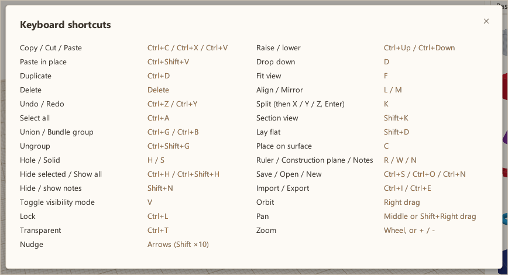

# 14. Keyboard and mouse

[Contents](README.md) · Previous: [The shape library](13-shape-library.md)

Every key and mouse action in one place. In ScottiCAD, press **?** (or
**F1**) to see the list of keys on screen.

## The view

| To | Do this |
|---|---|
| Orbit | Drag with the right button |
| Pan | Drag with the middle button, or **Shift** + drag with the right button |
| Zoom | Mouse wheel, or **+** and **-** |
| Fit the selection (or everything) in the view | **F** |
| Look straight at a side | Click a face of the view cube |

## Selecting

| To | Do this |
|---|---|
| Select a shape | Click it |
| Add to the selection, or take out of it | **Shift** + click |
| Select several | Drag a box round them, starting on empty space |
| Select everything | **Ctrl+A** |
| Select nothing, or leave a tool | **Esc** |

## Editing

| Action | Keys |
|---|---|
| Copy, cut, paste | **Ctrl+C**, **Ctrl+X**, **Ctrl+V** |
| Paste in place | **Ctrl+Shift+V** |
| Duplicate | **Ctrl+D** |
| Delete | **Delete** |
| Undo | **Ctrl+Z** |
| Redo | **Ctrl+Y**, or **Ctrl+Shift+Z** |

## Shapes and groups

| Action | Keys |
|---|---|
| Make a hole | **H** |
| Make a solid | **S** |
| Union group | **Ctrl+G** |
| Bundle group | **Ctrl+B** |
| Ungroup | **Ctrl+Shift+G** |
| Transparent, on and off | **Ctrl+T** |
| Lock, on and off | **Ctrl+L** |
| Hide the selection | **Ctrl+H** |
| Show everything | **Ctrl+Shift+H** |
| Hide and show shapes one by one | **V** |

## Moving

| Action | Keys |
|---|---|
| Nudge across the plate by one snap step | **Arrow keys** |
| Nudge by ten steps | **Shift** + arrow keys |
| Raise or lower by one step | **Ctrl+Up**, **Ctrl+Down** |
| Raise or lower by ten steps | **Ctrl+Shift+Up**, **Ctrl+Shift+Down** |
| Drop onto the plate | **D** |

## While dragging

| Dragging | Hold | To |
|---|---|---|
| A shape | **Shift** | Move in a straight line |
| A shape | **Alt** | Drag a copy |
| A size handle | **Shift** | Keep the proportions |
| A size handle | **Alt** | Size about the middle |
| A turn handle | **Shift** | Turn in steps of 45° |
| A new shape from the panel | **C** | Place it on the plate, ignoring other shapes |
| Anything | **Esc** | Cancel the drag |

## Tools

| Tool | Key |
|---|---|
| Align | **L** |
| Mirror | **M** |
| Ruler | **R** |
| Construction plane | **W** |
| Notes | **N** |
| Hide and show notes | **Shift+N** |
| Place on surface | **C** |
| Lay flat | **Shift+D** |
| Split (then **X**, **Y** or **Z**, and **Enter**) | **K** |
| Section view | **Shift+K** |

## Files

| Action | Keys |
|---|---|
| New design | **Ctrl+N** |
| Open | **Ctrl+O** |
| Save | **Ctrl+S** |
| Save as | **Ctrl+Shift+S** |
| Import | **Ctrl+I** |
| Export | **Ctrl+E** |

## Typing numbers

| Key | Does |
|---|---|
| **Enter** | Keeps what you typed |
| **Esc** | Leaves the number as it was |
| **Tab**, **Shift+Tab** | Keeps what you typed and moves to the next or the previous size on the shape |
| **Ctrl+A** | Selects the whole number |

Numbers can be decimals (`12.5`), fractions (`1/8`, `1 1/2`) or carry a
unit (`25mm`, `2.5cm`, `1in`, `3/4"`).

## The scripting console

| Action | Keys |
|---|---|
| Run the script | **F5**, or **Ctrl+Enter** |
| Stop a running script | **Ctrl+C** |
| Save the script | **Ctrl+S** |
| Open a script | **Ctrl+O** |

These apply while the console's editor has the keyboard. Click in the 3D
view to give the keys back to the design.

---

[Contents](README.md) · Previous: [The shape library](13-shape-library.md)
