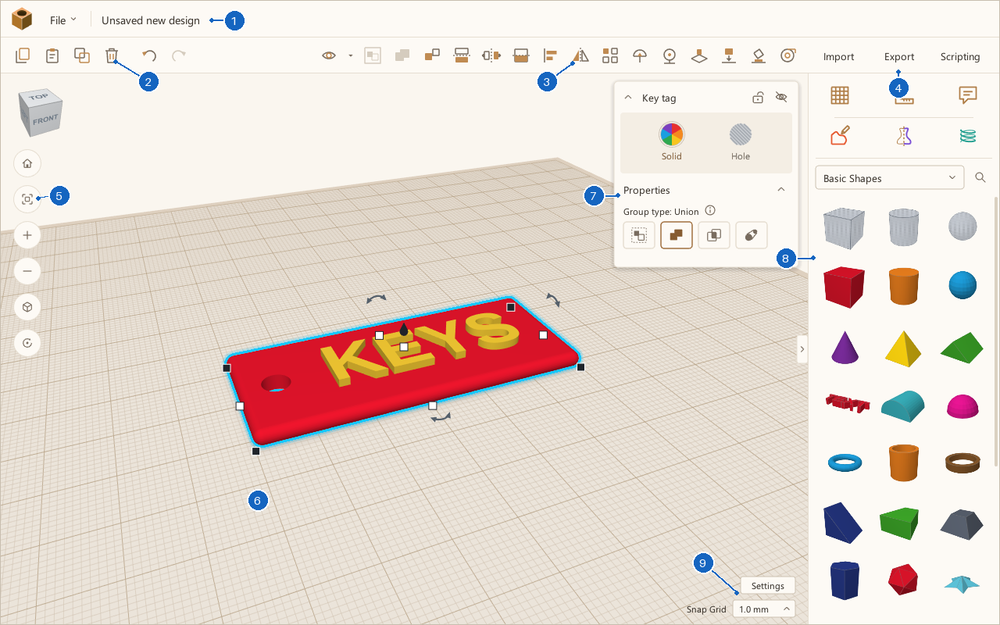

# ScottiCAD user manual

ScottiCAD is a 3D modelling program for makers. You build a part the way
you would with blocks: drag shapes onto the build plate, turn some of them
into holes, and group them so the holes are cut away. Then you export the
part for your 3D printer.

This manual starts with a short tutorial and then covers each part of the
program in turn. It describes ScottiCAD 0.4.

## Contents

**Start here**

1. [Getting started](01-getting-started.md): the window, and a first part
   from start to finish
2. [Looking around](02-looking-around.md): turning, moving and zooming the
   view

**Building**

3. [Shapes](03-shapes.md): the shape panel, properties, colours, text,
   and drawing your own shapes as sketches
4. [Moving, sizing and turning](04-moving-and-sizing.md): selecting,
   handles, exact sizes and the snap grid
5. [Holes and groups](05-holes-and-groups.md): cutting shapes away,
   joining them and repeating them in patterns
6. [Lining up and measuring](06-aligning-and-measuring.md): align, mirror,
   the ruler, the construction plane and notes
7. [Split, stretch and section view](07-split-and-section.md): cutting a part in
   two, making it longer or shorter, and looking inside one

**Files and printing**

8. [Opening, saving, importing and exporting](08-files.md)
9. [Getting ready to print](09-printing.md): the filament estimate and the
   print check
10. [Settings](10-settings.md): units, the build plate and themes

**Going further**

11. [Scripting](11-scripting.md): building with code
12. [Working with an AI assistant](12-ai-assistant.md)

**Reference**

13. [The shape library](13-shape-library.md): every shape, with pictures
14. [Keyboard and mouse](14-keyboard-and-mouse.md)

## About the pictures

The screenshots show ScottiCAD on Windows in its **Tan** theme. On Linux
the window looks the same. Yours may use another theme
([Settings](10-settings.md) has all six).

The pictures are made by a script,
[`make_images.py`](make_images.py), which drives ScottiCAD and builds
every model in them from the shape library. Run it again after the
program changes to bring the pictures up to date.
